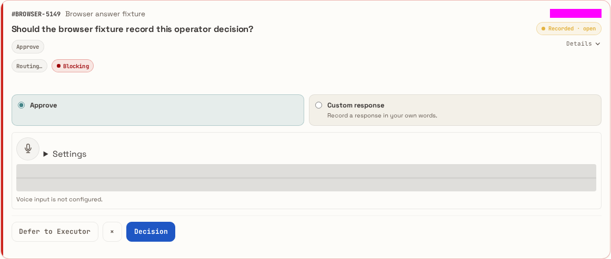
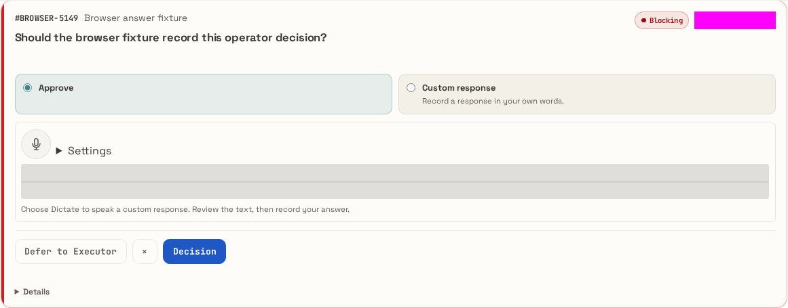
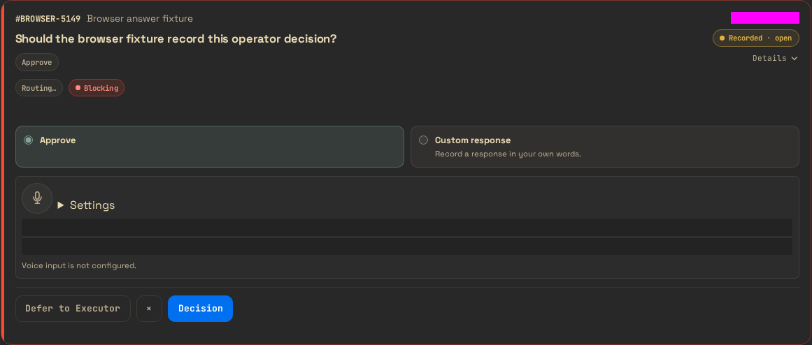
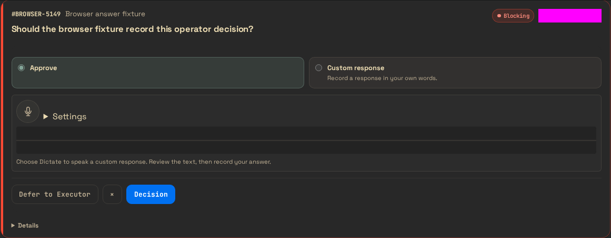
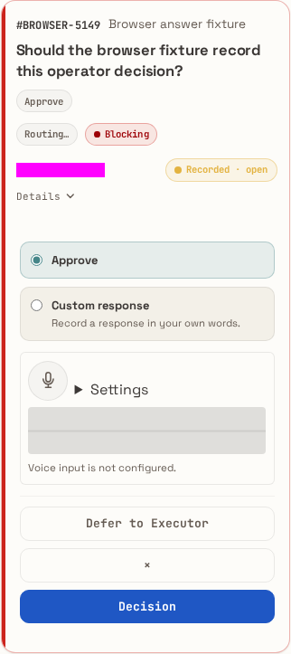
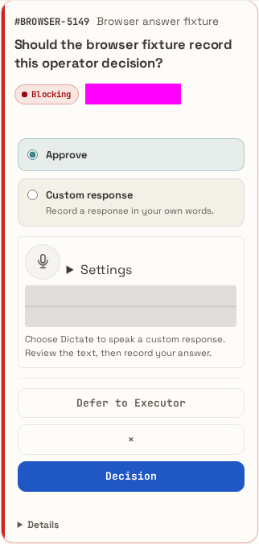
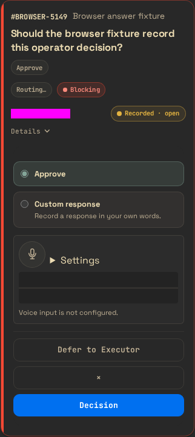
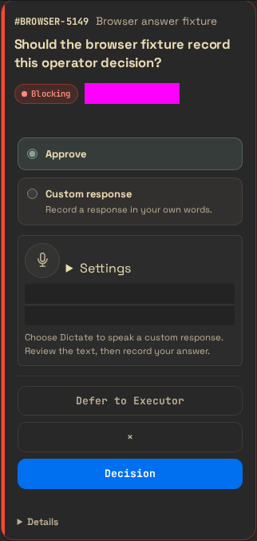

# Commands page redesign (#7761)

The `/commands` card had grown to about six pills, two option styles, and a question
printed twice. This redesign keeps the Command data model, APIs, and answer semantics.
It changes only what the card shows and where.

## Before and after

The images are the Playwright baselines in
`src/browser/tests/command-answer.browser.spec.mjs-snapshots/`. They show the seeded
Command fixture, with its age masked.

| | Before | After |
| --- | --- | --- |
| Light 1440 |  |  |
| Dark 1440 |  |  |
| Light 390 |  |  |
| Dark 390 |  |  |

The after images serve as the mock. They are rendered from the dashboard's own CSS,
which uses the `packages/aiur-style` tokens (`--line`, `--surface`, `--blocking-line`,
`--aiur-color-focus`), so the mock and the shipped page cannot drift.

## The card

| Part | Rule |
| --- | --- |
| First line | Ticket id and title, or **From Executor** as plain text for the Executor's own asks |
| Question | Rendered once as the heading. A native single question with the same text labels its option group with the heading (`aria-labelledby`) instead of a second legend. |
| Pills | At most two: **Blocking** (only when it blocks) and age (`asked 5m ago`) |
| Options | One style: radio cards. The two option-preview chips are gone. |
| Actions | One primary button. **Defer to Executor** stays a ghost button. |
| `×` | Moving dismiss to the top right is #7759, so this change leaves the button in place. |
| **Details** | One `
` disclosure with the context summary, the recommendation and its rationale, lifecycle status, routing, overrides, agent and model, answer actor, and version |

Clicking the card head still opens the full record at `/commands/:id`. That view keeps
its option reference list (risk, benefits, media), because it documents each option
rather than offering a second way to answer.

## Filter bar

The bar now has five filters, each with a count: **Needs you**, **With Executor**,
**From Executor**, **Blocking**, **All**.

- The duplicate `From Executor` link (`?requester=executor`) is gone. The URL still
  works, with its page-scoped count and **Next retained page**.
- **Open** showed the same cards as **All**.
- **Resolved** showed no cards at all, because resolved Commands live in the history
  table below. `?filter=open` and `?filter=resolved` still work.

## Not changed

- The voice-dictation block on the card. It is part of the Custom-response answer path,
  and its spec drives dictation from the card.
- Command data, API responses, answer, defer, and dismiss events.
