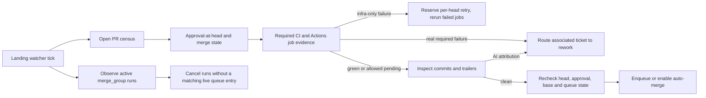

# Approved PR landing watcher

## Goal Capsule

Give the daemon ownership of approved PRs until they merge or need human repair, including infra-only CI recovery and stale merge-queue cleanup. Follow the ticket acceptance criteria and repository operating instructions. Stop before self-merging; GitHub's queue/auto-merge and human review remain the merge boundary.

## Product Contract

### Requirements

- R1. The daemon watches every open pull request whose latest approval applies to its current head, regardless of ticket state, and obtains the required `ci gate` verdict for that head.
- R2. Infrastructure failures (superseded/concurrency cancellation, failed jobs with no steps or zero runtime, and runner errors) request `rerun-failed-jobs` with bounded per-head retries and backoff. A person-cancelled run with no newer run remains pending and raises the existing rerun-skipped attention.
- R3. A real required-job failure routes the associated ticket to rework with failing job/test details.
- R4. A green or clean pending PR can enter GitHub's merge queue or enable auto-merge only after the PR commit attribution check passes. AI co-author trailers block landing and route the ticket to rework.
- R5. Queue reconciliation cancels merge-group runs that no longer correspond to a live entry. A PR removed from queue due to conflict routes to rework. A queue failure proven flaky by another successful group containing the same PR is re-enqueued once and recorded against the flake ticket; repeated real failure routes to rework.
- R6. `aiur merge-policy` reports the landing watcher as running when it is active.

### Acceptance

- APPROVED + human-review ticket + infrastructure-failed `ci gate`: one rerun request, no rework.
- Same PR with real required job failure: ticket transitions to rework and records concrete failures.
- Green approved PR is landed through queue or auto-merge; AI co-author trailer blocks it and routes to rework.
- Stale merge-group Actions run is cancelled.
- Human-cancelled latest run remains pending with `rerun_skipped`.
- `aiur merge-policy` shows watcher running.

### Scope

One daemon-owned landing watcher and its persistence/API/test support. The watcher owns approved PRs until merged, closed, approval/head invalidation, or rework. This does not change agent-workspace push guards or make the daemon itself merge PRs outside GitHub's merge queue/auto-merge policy. Every implementation requirement and acceptance case in the issue is in scope. Product behavior is taken directly from issue #4457; technical design choices below are repository-grounded.

## Planning Contract

### Key Technical Decisions

- KTD1: Use a dedicated GenServer because the watcher performs independent periodic work and must run when no worker ticket is in `ci-wait`.
- KTD2: Use governed GitHub transport and daemon-owned persistence; fail closed on missing or incomplete approval/check/queue evidence.
- KTD3: Key destructive or retry actions by current PR head and re-read immediately before mutation to avoid acting on stale approval or queue state.
- KTD4: Count a retry durably before issuing it so restarts cannot duplicate rerun requests; cap retries per head and back off between attempts.
- KTD5: Route ticket transitions through `TicketTransition.write_state`, never raw labels.

### High-Level Technical Design

The watcher is supervised independently of ticket worker state. Reads and writes use the governed GitHub transport; the watcher reserves retry/landing actions in its durable journal before making external mutations. Each mutation is fenced by PR number, current head SHA, configured base, and current approval-at-head. Queue entries and merge-group Actions runs are reconciled from live GitHub state rather than inferred from the ticket label.

## Implementation Units

### U1. Discovery, observation, and per-head recovery

**Files:** `src/lib/aiur/landing_watch*`, `src/lib/aiur/events/github_ci_poller/evaluation.ex`, `src/lib/aiur/github/pull_requests*`, `src/lib/aiur/application/children.ex`, `src/test/aiur/landing_watch/*`.

Add a supervised watcher that periodically enumerates open PRs and fetches authoritative GraphQL approval-at-head, required checks, mergeability, auto-merge, and queue state. Reuse `GithubCIPoller.Evaluation` for required-check verdicts, and inspect Actions run jobs for zero-step/zero-duration and runner failures. Preserve human-cancelled behavior. Persist bounded attempts/backoff keyed by PR and head in a daemon-owned landing journal; do not reuse the issue-keyed recovery store without changing its schema. Do not route a human-review ticket through ci-wait-only selection.

**Tests:** `src/test/aiur/landing_watch/classification_test.exs` covers required-check versus infrastructure failures, cancelled-run ownership, superseded runs, and zero-step/zero-runtime runner failures. `src/test/aiur/landing_watch/persistence_test.exs` covers per-head attempt caps, backoff and restart idempotency.

### U2. Landing and queue ownership

**Files:** `src/lib/aiur/landing_watch/landing.ex`, `src/lib/aiur/landing_watch/queue_reconciliation.ex`, `src/lib/aiur/github/merge_queue.ex`, `src/lib/aiur/pr_merge/queue.ex`, `src/lib/aiur/orchestrator/ticket_transition.ex`, `src/test/aiur/landing_watch/landing_test.exs`, `src/test/aiur/landing_watch/queue_reconciliation_test.exs`.

Before enqueue/auto-merge, fetch commits and validate trailers against the repository's AI attribution rule, and revalidate current approved head immediately before mutation. Route blocking findings to the matched ticket's rework state via `TicketTransition.write_state`, with failing job/test details in the existing CI failure feedback path. Reconcile merge_group runs against live queue entry identity, PR head and configured base; cancel orphan runs. Handle queue removal/conflict and one-time proven-flake re-enqueue with durable idempotency. Locate or add a daemon-owned flake-recording event/contract; the current repo has no obvious flake-ticket API, so this criterion must not be reported complete until an actual recording path exists.

**Tests:** landing tests prove clean approved heads enqueue once, AI co-author trailers route to rework before any mutation, and head/approval changes abort. Queue tests prove stale runs are cancelled, current runs are retained, conflict removal routes to rework, and the matched same-PR success permits one flake retry only.

### U3. Status and verification

**Files:** `src/lib/aiur/merge_policy_cli.ex`, `src/test/aiur/agent_control_cli_merge_policy_test.exs`, `website/docs-app/reference/merge-policy.md`, `website/docs-app/apis/github.md`.

Expose watcher health in `aiur merge-policy`, document its behavior in the existing merge-policy and GitHub API pages, and add focused tests for all acceptance cases, including persistence/restart and duplicate poll idempotency. Keep the existing `watcher=` token as the main-watch indicator and add a separately named landing watcher indicator so the two consumers are not conflated.

**Tests:** CLI tests distinguish main-watch and landing watcher states; the affected-test selector should execute all new watcher tests and existing merge-policy CLI mirrors.

## Verification Contract

### Test Scenarios

- Approved PR under `human-review` gets one infra rerun and no rework.
- Newer run detection distinguishes supersession/concurrency cancellation from a person cancellation.
- Failed check with real steps/runtime produces rework details.
- Required-check selection ignores irrelevant red checks.
- Approved green head enters queue exactly once; AI trailer produces rework and no queue mutation.
- Approval or head changes between read and mutation prevent stale enqueue.
- Queue run with no matching live PR/head/base is cancelled; matching active run is retained.
- Conflict removal routes to rework; same-PR successful group allows only one re-enqueue and records flake; repeated failure routes to rework.
- Persistence survives watcher restart and does not repeat an action already recorded.
- Watcher status distinguishes running, unavailable and not running.

- Add focused module tests for classifier decisions, durable idempotency, and each watcher action.
- Compile, format, run `mix aiur.affected_tests` and its selected tests from `src/` with `--max-cases 4`.
- Before handoff, run `mix lint` from `src/`, `python3 scripts/check-bare-assert-receive.py`, and the PR structure gate against the configured base.
- Manual CLI verification is an Executor-checkout responsibility because the manual harness is blocked in ticket workspaces.

## Scope Boundaries

### In scope

- Repo-wide approved PR ownership through GitHub merge queue/auto-merge, with bounded CI recovery and stale Actions queue-run cleanup.
- Rework routing for real failures, attribution violations and merge conflicts.

### Deferred to Follow-Up Work

- Automatic creation of a new flake issue if the repository has no existing durable flake-ticket association/recording contract. The watcher must still expose the proven flake evidence and retry idempotently; the exact absence must be reported rather than misrepresented as full R5 completion.

## Definition of Done

- All R1–R6 requirements and acceptance paths have production implementation and tests; no acceptance criterion remains a stub.
- The watcher is supervised, its actual runtime health is visible in `aiur merge-policy`, and its persistence survives daemon restarts without duplicate queue/rerun mutations.
- User-facing behavior is documented in `website/docs-app/apis/github.md` and `website/docs-app/reference/merge-policy.md`.
- Scoped local checks pass, PR body contains current-head test evidence, and the ready PR targets `main`.

## Risks & Dependencies

- A repository-wide PR census can be expensive; use bounded pagination, existing batch reads, and visible caller attribution. Do not claim savings without production population measurements.
- GitHub queue and Actions APIs can race. Every mutation requires fresh identity/head/base evidence and idempotent durable reservations.
- CI gate failures can hide underlying cancelled jobs; inspect run/job evidence rather than classifying from aggregate conclusion alone.
- The issue does not define an existing flake-ticket lookup/write API. Planning must locate one before implementing this branch; if absent, keep ticket-local failure routing complete and avoid silently claiming flake recording is satisfied.
