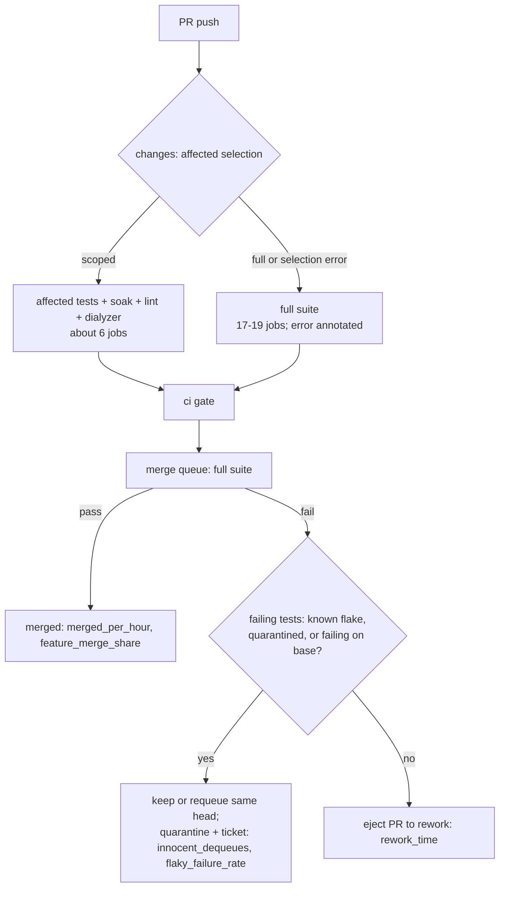

# fix: Increase CI and test stability so feature PRs land faster

## Goal Capsule

**Objective.** Return fleet capacity and wall-clock time from test and CI work to feature work. Each remedy ships behind a before/after experiment so its effect is measured, not assumed.

**Authority.** Kevin's request of 2026-10-21 ("a lot of flaky tests and failed CI ... very little progress on the actual features"), the measured findings in this plan (Appendix A), and the coordinator's added requirement that every change is analyzable through `aiur experiments`.

**Stop conditions.** Stop and ask Kevin before any unit marked **Kevin decides**. Stop a remedy when its experiment reports the primary metric moved the wrong way with the planned sample.

**Execution profile.** U1 lands first, so the 14-day baselines exist before any remedy ships. U2 is a small fix with the largest measured saving and lands next. The Executor creates each experiment when its remedy merges (specs in "Measuring each remedy").

---

## Product Contract

### Summary

The hunch is correct. In the last 14 days, 36% of merged PRs (24.5% by a strict test-fix definition) were test, flake or CI work, and only 23.5% were feature work. In the last 3 days the shares were 43% and 13%. 31.5% of filed issues (54% in the last 3 days) came from a CI failure or a flake. PR CI failed 43% of decided runs (28% in the last 3 days). Main failed 31% (20%).

The single largest cause of lost time is a defect, not flakiness. Since #4613 (2026-10-16), affected-test selection fails on every PR (`mix run` executes at the repository root, which has no `mix.exs`). The fallback silently forces the full suite, so every PR runs 17-19 jobs and about 28 minutes of CI instead of 6 jobs and about 8 minutes. The full suite then exposes every PR to unrelated flakes: 60% of sampled PR coverage failures were in modules that also failed on main.

### Problem Frame

Feature PRs, once open, are not slowed much per PR: feature PRs had 0.20 rework rounds each (0.11 not caused by review) and a 1.0-hour median in the merge queue. The cost is elsewhere:

1. **Capacity.** Agents spend about a third of merges on test and CI fixes. The same root-cause classes (leaked processes, global state, deadline-based readiness, broad assertions) were named in `docs/plans/2026-08-21-001-fix-ci-test-flake-mechanisms-plan.md`. They are still fixed one test at a time.
2. **CI wall time per cycle.** Each PR runs about 2.6 completed CI cycles, each about 26 minutes, because the full suite always runs.
3. **Innocent dequeues.** 123 merge-queue removals were later merged with the same head (22 of 29 `failed_checks` removals, 101 of 201 `manual` removals). They cost 172 PR-hours in 14 days.
4. **Runner saturation.** The hosted-runner ceiling is about 60 concurrent jobs. It is saturated in busy hours; queued jobs reach 100-150 and job waits reach 20-48 minutes. Browser smoke uses 48% of CI job-minutes and causes about 5% of failed jobs.

### Requirements

- R1. Every remedy is measurable through `aiur experiments` with a frozen 14-day baseline before it ships.
- R2. The metrics the remedies need and the catalog lacks are added to the built-in `delivery-speed` pack.
- R3. PRs run affected tests by default, as `.claude/skills/aiur-agent/SKILL.md` already states; the merge queue runs the full suite. A selection failure is visible, not silent.
- R4. A merge-group failure removes only the PR that caused it. A PR whose failing tests are known flakes or also fail on the base stays queued or is requeued with the same head.
- R5. A test that fails on the base branch without a related change is quarantined and ticketed on its first qualifying failure, and quarantine entries have an owner and an expiry.
- R6. The recurring flake classes have deterministic test primitives and a ratcheting lint, so new instances cannot land and the existing count only falls.
- R7. CI spends fewer job-minutes per PR without losing merge-queue coverage.
- R8. Changes that cost money or change policy are presented to Kevin with evidence and are not implemented without his decision.

### Success Criteria

Measured by the experiments in "Measuring each remedy", against the frozen baselines:

- Share of merges that are feature work rises (baseline 23.5%; 12.9% in the last 3 days).
- PR CI wall time per PR falls (baseline median 25.6 min per run, 2.6 completed runs per merged PR).
- PR CI failure rate falls toward the PR-caused share (baseline 43%, 28% in 3 days).
- Same-head merge-queue removals fall (baseline 123 per 14 days).
- `main_red_events` falls (baseline 31% of main pushes red, 20% in 3 days).
- Flake-caused issues filed per day fall (baseline 438 in 14 days, about 31 per day).

### Scope Boundaries

In scope: CI workflow selection and fan-out, LandingWatch merge-group handling and quarantine policy, test-support primitives and a test lint, experiment metrics in the `delivery-speed` pack.

Out of scope: rewriting all 2,150 test files at once (the lint ratchet drives this over time); changing the build-order or fleet scheduling; changing review policy.

### Deferred to Follow-Up Work

- Consolidating the `pr body` workflow (5,044 single-job runs in 14 days) into `ci gate`. Each run is short; the saving is small.
- Stopping full CI on push to main (#4281 intended this). It needs a decision about main-watch evidence that depends on push runs.
- Fixing the individual flaky modules listed in Appendix A. Agents fix those through the quarantine tickets that U4 files.

---

## Planning Contract

### Key Technical Decisions

- **KTD1. Metrics before remedies.** U1 adds the missing metrics first, so each experiment freezes a real 14-day baseline at creation. Without it, U2's effect would be mixed with later changes.
- **KTD2. New metrics come from data the daemon already reads.** `Aiur.RunTelemetry.window_event_sources/4` already fetches merged pulls and workflow runs for `main_red`. The new metrics extend that GitHub window source and the LandingWatch journal; they do not add a new collector. Consumer-pack `script` sources cannot be used because the runner strips GitHub credentials from script environments.
- **KTD3. Fix selection; keep the full-CI fallback, but make it loud.** A selection error still forces full CI (safe), but it writes a `::error::`, a step-summary line and a run annotation, and a guard test runs the real selection command from the same directory CI uses. A silent fallback hid this defect for five days.
- **KTD4. Blame by evidence the code already gathers.** `Aiur.LandingWatch.MergeGroupFailureEvidence` already reads recent main failure paths, and `MergeGroupRequeue` already requeues. U3 makes the eject decision use them before removal, rather than adding a new rerun loop.
- **KTD5. Quarantine on the first base failure.** The current rule needs two merge groups or a base fail-then-pass inside 24 hours. A failure on the base with no related change is already proof that the PR under test is innocent.
- **KTD6. Primitives plus ratchet, not a rewrite.** Add helpers to `src/test/support/` and a lint with a committed count per pattern. CI fails when a count rises. Follow `scripts/test-component-ratchet.py` and `scripts/test-check-bare-assert-receive.sh`.
- **KTD7. Retries are tracked evidence, never silent.** A retry runs only the failed tests, once, only when each one is already a known flake or failed on the base, and never for a test file the PR touches. Each retry is recorded as flake evidence. Policy choice: **Kevin decides**.
- **KTD8. Do not self-host on this box.** The host already runs at load 19-24 on 16 cores from the agent fleet. CI on it would compete with agents and make load-dependent flakes worse. Larger hosted capacity is a cost decision: **Kevin decides**.

### High-Level Technical Design

Flow of one PR after U2-U4, with the metric each step feeds:

### Remedy ranking

Ranked by measured time saved per feature PR. Savings are estimates from the 14-day data; the experiments confirm or reject them.

| Rank | Remedy | Evidence | Expected effect | Cost | Risk |
|---|---|---|---|---|---|
| 1 | U2 Restore affected-test selection | 27 of 30 sampled PR `changes` logs since 10-19 say "affected test selection failed; forcing full CI"; cause `mix run` at repo root (#4613). Affected runs: median 7.6 min wall, 12.8 job-min, 6 jobs; full runs: 27.8 min, 74 job-min, 17 jobs | About 20 min wall and 60 job-min saved per PR CI cycle; about 50 min wall per merged PR (2.6 cycles). Removes most unrelated-flake exposure in PR CI (60% of PR coverage failures were main-shared modules) | Very low | More failures appear first in the merge queue; U3 limits the cost |
| 2 | U3 Merge-group blame | 123 same-head removals in 14 days, 172 PR-hours; 76% of `failed_checks` removals were innocent | About 10 min per merged PR on average; about 1.4 h for each affected PR (12% of PRs) | Medium | A real regression kept in the queue fails again; bounded by one requeue per head |
| 3 | U5 + U6 Isolation primitives, lint ratchet, suite-wide leak guard | 258 strict fix PRs (24.5% of merges); 438 CI/flake issues; static counts: `Application.put_env` 1,814 hits in 477 files, `System.put_env` 595 in 232, `Process.sleep` 405 in 205, `capture_log` 314 in 163; leak guard in only 5 files | Fewer new flakes; the fix-PR share falls over weeks. If half of strict fix PRs disappear, about 9 agent PR slots per day return to features | High (incremental) | Ratchet blocks unrelated PRs if counts are not per-file; use a baseline file |
| 4 | U4 Quarantine on first base failure, with owner and expiry | Main red on 31% of pushes (20% in 3 days); quarantine churns between 5 and 20 entries; 11 of 12 entries share one ticket (#4463) | Shorter main-red windows; fewer duplicate flake tickets; fewer PRs blocked behind red main | Low | Over-quarantine hides a real break; expiry and the nightly quarantine job bound it |
| 5 | U7 Path-gate browser smoke on PRs | Browser smoke is 47.7% of CI job-minutes and about 5% of failed jobs; runner ceiling about 60 concurrent jobs with job waits p90 4.5-21 min and max 48 min | About 50 job-min per PR CI run; lower queue waits at peak | Low | A web regression is first seen in the merge queue |
| 6 | U8 Retry known flakes only, with tracking (**Kevin decides**) | 12.8% of PR runs re-ran; about 0.67 failed cycles per PR were main-shared | After U2, small: about 5-10 min per PR | Low | Masks a new regression if the "known" list is wrong |
| 7 | U9 Runner capacity (**Kevin decides**, costs money) | 60-job ceiling saturated in busy hours since at least 10-15 | After U2 and U7, demand drops by about half, so likely unnecessary | Money | None technical |
| 8 | U10 Agent local test policy (**Kevin decides**) | No direct measurement; agents run `make all` on a host at load 19-24 | Unknown; measure first | Low | Weaker local proof |

### Assumptions

- The jobs API is the truth for runner concurrency. The Executor's 05:10Z observation ("2 in progress, at most 2 jobs") counted workflow runs; the jobs API shows 58-60 jobs on runners at every 5-minute sample from 04:50Z to 05:40Z, held by 5 merge-group runs (40 jobs) and 5 PR runs (20 jobs).
- `feature_tags` and `epic` are the only feature-vs-infra cohort attributes the experiments predicate allows today (`src/lib/aiur/experiments/predicate.ex`). U1 adds a `tags.work_kind` capture tag so cohorts can split feature, test_ci, tooling and other work.
- The feature share also depends on how many build-order tickets were ready (the Paseo pack was paused for sign-off). Experiments stratify by `epic` to separate that effect.

### Open Questions

- Q1 (deferred). Should `tags.work_kind` use the classifier in Appendix A (titles, labels, test-only diffs) or only issue labels? Default: labels first, title rules as fallback.
- Q2 (Kevin decides). Retry policy for known flakes (U8): allow one tracked retry, or never retry?
- Q3 (Kevin decides). Larger hosted runner concurrency (U9): buy, or wait for U2 and U7 results?
- Q4 (Kevin decides). Agent local test policy (U10): keep `make all` before handoff, or run affected tests plus soak and leave the full suite to the merge queue?
- Q5 (deferred). Does `exists` on `feature_tags` with a nil value match? Check in U1 tests; if it does not, use `tags.work_kind` only.

---

## Implementation Units

### U1. Add CI-stability metrics to the delivery-speed pack

**Goal.** Add the metrics the remedies need, so baselines can be frozen before U2 ships.

**Requirements.** R1, R2.

**Dependencies.** None.

**Files.**
- `src/lib/aiur/experiments/packs/delivery_speed.ex` (definitions)
- `src/lib/aiur/experiments/packs/delivery_speed/periods.ex` (period metrics)
- `src/lib/aiur/experiments/window_events/github.ex` and `src/lib/aiur/run_telemetry.ex` (`window_event_sources/4` run and pull rows)
- `src/lib/aiur/landing_watch/journal.ex` (read-only source for queue removals and flake evidence)
- `src/lib/aiur/experiments/packs/delivery_speed/telemetry_source.ex` (`tags.work_kind` capture tag)
- `src/test/aiur/experiments/packs/delivery_speed_ci_metrics_test.exs` (new)
- `website/docs-app/concepts/experiments.md` (metric list)

**Approach.** Add these metrics with `pack: "delivery-speed"`:

| Metric | Kind / unit of analysis | Better | Data source |
|---|---|---|---|
| `ci_run_failure_rate` | binary / CI run (attrs: `event`, `workflow`) | lower | GitHub workflow runs for the required workflow (already fetched for `main_red`), extended to `pull_request` and `merge_group` events; value 1 for `failure`, 0 for `success`; cancelled and skipped excluded |
| `ci_rerun_rate` | binary / CI run | lower | Same rows; value 1 when `run_attempt > 1` |
| `merge_group_failure_rate` | binary / merge-group run | lower | Same rows filtered to `event == merge_group` |
| `innocent_dequeues` | count / merged PR | lower | LandingWatch journal removals, or PR timeline `RemovedFromMergeQueueEvent` with reason other than `merged`, where the PR later merged with the same head |
| `flaky_failure_rate` | rate / day (failed test-jobs with only known-flaky, quarantined or base-failing tests ÷ failed test-jobs) | lower | `MergeGroupFailureEvidence` and the quarantine journal records written by `MergeGroupQuarantine` and `FlakeRecorder` |
| `pr_ci_wall_time` | duration / PR CI run | lower | Same run rows: `updated_at - run_started_at` for decided runs |
| `ci_queue_wait` | duration / job | lower | Job rows (`started_at - created_at`) for runs in the window; sampled when the job budget is limited |
| `feature_merge_share` | bucketed / day | higher | `merged_pr` window events: share whose `tags.work_kind` (or linked-issue labels `build-lane:*`, `feature:*`, `build-order`) is feature |
| `flake_issues_filed` | bucketed / day | lower | Issues created with the `flake` or `main-fix` label |

Add `tags.work_kind` (feature, test_ci, tooling, other) to the ticket cohort attributes at dispatch, derived from issue labels with the Appendix A title rules as fallback (Q1).

**Patterns to follow.** `main_red` in `src/lib/aiur/experiments/window_events/github.ex`; period metrics in `src/lib/aiur/experiments/packs/delivery_speed/periods.ex`; coverage rules in `website/docs-app/concepts/experiments.md` (missing data is `not_captured`, never zero).

**Test scenarios.**
- A window with 3 failed and 7 successful `pull_request` runs and 2 cancelled runs gives `ci_run_failure_rate` 0.3 over 10 units.
- A run with `run_attempt` 2 counts once, as a rerun.
- A PR removed with `failed_checks`, then merged with the same head, counts 1 innocent dequeue; one with a new commit after removal counts 0.
- A day with no merged PRs reports `feature_merge_share` as not captured, not 0.
- Missing run rows (GitHub error) report `unavailable`, and other metrics stay usable.
- `aiur experiments metrics --json` lists the new ids with kind, unit and direction.
- A cohort filter on `tags.work_kind == feature` selects only feature tickets (covers Q5).

**Verification.** The catalog lists the new metrics; `aiur experiments create --draft` with each metric succeeds and reports coverage for the last 14 days.

### U2. Restore affected-test selection on pull requests

**Goal.** PRs run affected tests again, and a selection failure is visible.

**Requirements.** R3, R7.

**Dependencies.** U1 (baseline frozen).

**Files.**
- `scripts/classify-ci-changes.sh` (run the selection from `src/`, where `mix.exs` lives)
- `.github/workflows/ci.yml` (`changes` job: annotate when selection fails)
- `scripts/test-classify-ci-changes.sh` (guard test)

**Approach.** Run `mix run --no-start scripts/ci-test-selection.exs` from the Mix project directory with paths adjusted, as the pre-#4613 `elixir -r` call did. Keep the fallback to full CI, but emit `::error::affected test selection failed` with the first error line and add it to the step summary. Add a guard test that runs the real command from the same working directory as CI on a fixture path list and asserts a `scoped:N` result.

**Test scenarios.**
- A PR that changes one `src/lib` module selects `scoped:N` with N > 0 and does not run coverage partitions.
- A PR that changes `src/mix.exs` still selects full CI (configured `full_ci_paths`).
- A selection crash forces full CI and writes the error annotation and summary line.
- The guard test fails on the current `main` invocation (characterization of the defect).

**Verification.** On new PR runs, the `changes` log shows `affected tests selected: N` and the run has about 6 jobs; merge-group runs still run the full suite.

### U3. Blame merge-group failures on evidence before ejecting

**Goal.** Only the PR that caused a merge-group failure leaves the queue.

**Requirements.** R4.

**Dependencies.** U1.

**Files.**
- `src/lib/aiur/landing_watch/merge_group_failure_processor.ex`
- `src/lib/aiur/landing_watch/merge_group_failure_evidence.ex`
- `src/lib/aiur/landing_watch/merge_group_requeue.ex`
- `src/test/aiur/landing_watch/merge_group_blame_test.exs` (new)

**Approach.** Before a removal, classify each failing test: touched by a PR in the group, quarantined, on `.github/known-flaky-tests.txt`, or failing on the base in the last 24 hours (`recent_main_paths`). When no failing test is touched by a PR, keep the group's PRs (or requeue each with the same head once) and send the failure to quarantine evidence. When failing tests map to one PR's changes, eject only that PR. Record each decision in the LandingWatch journal so `innocent_dequeues` can read it.

**Test scenarios.**
- Group of 3 PRs; the failing test also failed on main 2 hours ago; no PR touched it: no PR is ejected, and one quarantine evidence record is written.
- Group of 3 PRs; the failing test file is changed by PR B only: only B is ejected.
- The same head is requeued twice after innocent failures: the second time it is ejected and an attention is raised.
- The evidence fetch fails: fall back to the current behavior and log the fallback.

**Verification.** In the journal, removals with a same-head later merge fall; the experiment for U3 reports `innocent_dequeues`.

### U4. Quarantine on the first base failure, with owner and expiry

**Goal.** A test that fails on the base without a related change leaves the required set at once and gets one fix ticket with an owner and an expiry.

**Requirements.** R5.

**Dependencies.** U3 (shares the classification).

**Files.**
- `src/lib/aiur/landing_watch/merge_group_quarantine.ex`, `quarantine_evidence.ex`, `quarantine_lifter.ex`
- `src/lib/aiur/test_quarantine.ex` (entry format: expiry date)
- `src/test/quarantine.txt`
- `src/test/aiur/landing_watch/merge_group_quarantine_flow_test.exs`, `src/test/aiur/test_quarantine_test.exs`

**Approach.** Lower the trigger to one base failure where no change in that push touched the test. Give each entry its own ticket (today 11 of 12 entries point to #4463) and an expiry date. On expiry, the nightly quarantine job result decides: lift if green for N runs, else escalate the ticket priority.

**Test scenarios.**
- One base failure in an untouched test quarantines it and files one ticket.
- A base failure in a test that the push changed does not quarantine; it opens a main-fix ticket.
- A second failure of a quarantined test does not file a duplicate ticket.
- An expired entry with green nightly runs is lifted; an expired entry still failing escalates.
- A malformed expiry is refused by `Aiur.TestQuarantine.read/1` with a clear error.

**Verification.** Each quarantine entry has a distinct ticket and expiry; `main_red_events` and `flake_issues_filed` are reported by the U4 experiment.

### U5. Deterministic test-isolation primitives and a ratcheting lint

**Goal.** New tests cannot add the recurring flake patterns, and existing counts can only fall.

**Requirements.** R6.

**Dependencies.** None (can run in parallel with U2-U4).

**Files.**
- `src/test/support/test_support/isolation.ex` (new helpers)
- `scripts/check-test-isolation.py` (new lint) and `scripts/test-check-test-isolation.py`
- `scripts/test-isolation-baseline.json` (per-file counts)
- `.github/workflows/ci.yml` (`lint` job step)
- `src/AGENTS.md` (test rules)

**Approach.** Helpers for the five recurring classes: scoped application and OS environment changes that restore on exit and refuse `async: true`; owned process start that registers with the leak guard; per-test PubSub topic and registry names; causal readiness helpers (await an event or telemetry signal, not a deadline); log capture scoped to the test's own processes. The lint counts, per file: `Process.sleep` in tests, `Application.put_env`/`System.put_env` in `async: true` modules, `capture_log` compared to an empty string, `PubSub.subscribe` to a literal global topic, and `spawn`/`Task.start` without an owner. It fails when a file's count rises above the baseline and rewrites the baseline only when counts fall.

**Patterns to follow.** `scripts/test-component-ratchet.py`; `scripts/test-check-bare-assert-receive.sh`; `scripts/check-test-time-bombs.py`.

**Test scenarios.**
- A new test file with `Process.sleep(100)` fails the lint with the file and line.
- Removing one `Process.sleep` from a baselined file passes and lowers the baseline.
- `Application.put_env` inside an `async: false` module passes; inside `async: true` it fails.
- The scoped-env helper restores the previous value after a test that raises.
- The log helper does not capture a warning logged by an unrelated process during the test.

**Verification.** The lint runs in the `lint` job; the baseline totals are recorded so the U5 experiment can relate counts to `flaky_failure_rate`.

### U6. Run the lifecycle leak guard for the whole suite

**Goal.** Every test that leaves a dispatched runner or a stray tool executor alive is named at its own teardown.

**Requirements.** R6.

**Dependencies.** U5 (owned-process helper).

**Files.**
- `src/test/support/test_support/lifecycle_leak_guard.ex`, `src/test/support/test_support/lifecycle_teardown.exs`
- `src/test/test_helper.exs`
- `src/test/aiur/test_support/lifecycle_leak_guard_suite_test.exs` (new)

**Approach.** Start the guard from `test_helper.exs` for all modules, in report-only mode for one week (findings written to the coverage partition summary and flake evidence), then failing mode. Extend it to tool-executor and poller processes (#5488).

**Test scenarios.**
- A test that dispatches a runner and does not stop it is reported with its module and test name.
- A test that stops its runner in `on_exit` is not reported.
- In failing mode the leaking test fails, not the next test.
- A leaked tool executor that logs after its test ends is attributed to the starting test.

**Verification.** Report-only findings list fall to zero before the switch to failing mode.

### U7. Run browser smoke on PRs only when web paths change

**Goal.** Cut CI job-minutes per PR run without reducing merge-queue coverage.

**Requirements.** R7.

**Dependencies.** U2.

**Files.**
- `.github/workflows/ci.yml` (`browser` job condition)
- `scripts/ci-policy.rb` (browser path set)
- `scripts/check-ci-gate.py` and a new `scripts/test-check-ci-gate.py` (gate accepts a skipped browser job on PRs)

**Approach.** On `pull_request`, run the 8 browser shards only when the PR changes `src/browser/`, `src/lib/aiur_web/`, `src/priv/static/` or browser fixtures. Merge groups always run them.

**Test scenarios.**
- A PR changing only `src/lib/aiur/orchestrator/` skips browser smoke and the gate passes.
- A PR changing `src/lib/aiur_web/` runs all 8 shards.
- A merge-group run always runs all 8 shards.

**Verification.** `pr_ci_wall_time` and `ci_queue_wait` in the U7 experiment.

### U8. Retry only known flakes, with tracking (Kevin decides)

**Goal.** A PR coverage partition that fails only on known flakes retries those tests once and records it.

**Requirements.** R8, R6.

**Dependencies.** U2, U4; Kevin's answer to Q2.

**Files.** `.github/workflows/ci.yml` (coverage partition step), `scripts/record-coverage-flakes.py`, `scripts/report-known-flaky-tests.sh`, `scripts/test-ci-flake-retry.py` (new).

**Approach.** After a failed partition, retry with only the failed tests when every failure is quarantined, on the known-flaky list, or failed on the base in 24 hours, and no failing test file is touched by the PR. Write a flake evidence artifact for each retry. Merge groups never retry.

**Test scenarios.**
- Two known-flake failures retry once; a green retry passes the job with a "retried known flakes" summary.
- One known and one new failure: no retry; the job fails.
- A failing test in a file the PR changed: no retry.

**Verification.** `ci_rerun_rate` and `rework_time` in the U8 experiment.

### U9. Runner capacity decision (Kevin decides)

**Goal.** Give Kevin the evidence to decide on hosted concurrency after U2 and U7 land.

**Requirements.** R8.

**Dependencies.** U2, U7 results.

**Files.** None. Test expectation: none -- decision only.

**Approach.** Present `ci_queue_wait` before and after U2 and U7. Recommend no self-hosting on this host (KTD8). If p90 queue wait stays above 5 minutes in busy hours, present the cost of larger hosted concurrency.

**Verification.** Kevin's decision is recorded in the plan's Open Questions.

### U10. Agent local test policy (Kevin decides)

**Goal.** Decide whether agents keep running the full suite locally before handoff.

**Requirements.** R8.

**Dependencies.** U2.

**Files.** `src/AGENTS.md`, `.claude/skills/aiur-agent/SKILL.md` (only after Kevin's decision). Test expectation: none -- policy text.

**Approach.** Measure first: add the agent's local test duration to the existing handoff telemetry, then present it with `start_to_pr_open` to Kevin.

**Verification.** Kevin's decision is recorded; if the policy changes, the U10 experiment measures it.

---

## Measuring each remedy

The ready-to-run `aiur experiments create` spec for each remedy is in [`2026-10-21-001-fix-ci-stability-measurement.md`](2026-10-21-001-fix-ci-stability-measurement.md).

## Verification Contract

- Elixir units (U1, U3, U4, U5 helpers, U6): run the named test files with `mix test` from `src/` in a worktree, then `make lint` and `make dialyzer`. Do not run the suite in the main checkout.
- Script and workflow units (U2, U5 lint, U7, U8): the `scripts/test-*.{sh,py}` tests named in each unit, and `scripts/check-ci-gate.py` tests.
- CI behavior (U2, U7): one PR run shows the expected job set in the `changes` summary; one merge-group run still runs the full suite.
- Experiments (U1): `aiur experiments metrics --json` lists the new metrics; a `--draft` create per metric reports coverage for the previous 14 days.

## Definition of Done

- U1 merged and baselines visible before U2 merges.
- U2-U7 merged, each with its experiment created by the Executor at merge.
- U8-U10 presented to Kevin with evidence; decisions recorded in Open Questions.
- No abandoned experimental code left in the diff; quarantine entries each have a ticket and an expiry.

---

## Appendix

### A. Measured findings (2026-10-06 to 2026-10-21 05:46Z)

All `gh` calls ran with `GITHUB_TOKEN` and `GH_TOKEN` unset. Windows: 14 days from 2026-10-06T00:00Z; 3 days from 2026-10-18T00:00Z.

**Merged PRs.** `gh pr list -R aiur-team/aiur --state merged --search "merged:2026-10-DD" --limit 1000 --json number,title,labels,additions,deletions,files,createdAt,mergedAt,closingIssuesReferences` per day: 1,055 PRs; 974 linked issues read through GraphQL. Classes: test_ci = linked issue labelled `flake` or `main-fix`, or a title that matches flake, test, CI, leak, quarantine, coverage, merge queue, runner, isolate, deterministic, lint, fixture, partition, smoke or stabilize, or only test-path files changed; feature = MP-/PSO- IDs or linked issue labels `build-lane:*`, `feature:*`, `build-order`; tooling = executor, handoff, worker, dispatch, rework, wake, review, agent, ticket, budget, label or alert in the title; other = the rest.

| Window | Merged | Feature | Test/CI | Tooling | Other |
|---|---|---|---|---|---|
| 14d PRs | 1,055 | 248 (23.5%) | 376 (35.6%) | 176 (16.7%) | 255 (24.2%) |
| 14d changed lines | 926k | 40.4% | 37.3% | 7.6% | 14.7% |
| 3d PRs | 233 | 30 (12.9%) | 100 (42.9%) | 41 (17.6%) | 62 (26.6%) |
| 3d changed lines | 109k | 32.9% | 31.6% | 13.4% | 22.2% |

Strict test-fix definition: 258 (24.5%) in 14 days, 82 (35.2%) in 3 days; 198 test-only diffs. Test/CI share per day from 10-08: 32, 22, 46, 43, 55, 28, 23, 36, 45, 35, 42, 53%. Feature merges per day: 37, 75, 11, 25, 1, 26, 21, 13, 9, 21, 7, 2.

**Issues.** 1,390 created in 14 days: test_ci 41.9%, feature 27.8%, tooling 16.6%, other 13.6%. Filed because of a CI failure or flake: 438 (31.5%); `flake` label 56. In 3 days: 215 created, test_ci 65.1%, feature 0.9%, CI/flake-caused 117 (54.4%).

**CI runs.** `gh api --paginate "repos/aiur-team/aiur/actions/runs?per_page=100&created=FROM..TO"` in 3-hour slices: 17,033 runs; 7,511 `ci`.

| `ci` event | Runs | failure ÷ (success + failure) | Reruns (attempt > 1) | Wall median / p90 |
|---|---|---|---|---|
| pull_request | 5,381 | 43.0% (1,195 / 2,782) | 12.8% | 25.6 / 64.8 min |
| merge_group | 1,316 | 34.0% (342 / 1,006) | 1.0% | 28.2 / 58.3 min |
| push to main | 790 | 31.1% (153 / 492) | 4.1% | 30.8 / 108.8 min |

3 days: PR 28.3%, merge group 25.9%, main 19.7%. Failing jobs in 913 failed runs: coverage partitions dominate on every event; then merge ruleset drift (117, only 10-10 to 10-11), lint, browser smoke, workflow security, dialyzer.

**Logs.** 240 failed coverage and browser job logs (`gh api repos/aiur-team/aiur/actions/jobs/<id>/logs`), 80 per event. "exceeded its 20m bound": 0 real hits (the string appears only in the echoed step script). Median 1 failing test per failed job (p90 4). 179 distinct failing modules, 69 seen once. Most frequent: `Aiur.AgentRunner.TurnLoopNoopBoundTest` (52 test failures, all events), `Aiur.ElevenLabs.RealtimeTest` 34, `Aiur.Orchestrator.ReconciliationTasksTest` 30, `Aiur.Regression.SharedPrewarmE2ETest` 30, `Aiur.GitHub.AppIdentityTest` 23, `Aiur.ProviderMeters.EventsTest` 21, `AiurWeb.VoiceChannelTest` 19, `Aiur.OperatorSendTimeoutTest` 18. Most frequent single tests are architecture guards: `Aiur.AiurAgentSkillTest` 12, `Aiur.OrchestratorStatusTest` "dashboard projection excludes unrelated orchestration state" 12, `Aiur.Regression.ProgressRendererBoundaryTest` 11. PR-caused vs shared: 41 of 68 PR coverage failures (60%) were only in modules that also failed on main; merge groups 17 of 67 all-on-main, 6 partly.

**Merge queue** (GraphQL `timelineItems` for all 1,055 PRs): 722 merged through the queue (333 bypassed it, all before 10-18). Removals other than merge: manual 201, merge_conflict 43, failed_checks 29. Same-head later merge: 22 of 29 failed_checks, 101 of 201 manual; 172 PR-hours of delay. Feature PRs entered the queue 1.57 times each in the last 3 days.

**Time.** Ready to merge: all PRs median 3.54 h (p90 56.5 h); feature 3.46 h (41.0 h); feature in 3 days 5.01 h (20.7 h). Ready to first approval: feature 0.61 h. Queue add to merge: feature 1.04 h (6.95 h). Rework rounds (`agent:rework` on the linked issue): 0.39 per PR overall (228 after review, 157 other); feature 0.20 (23 review, 27 other); tooling 0.63. Time under `agent:ci-wait`: mean 0.30 h per PR.

**Quarantine.** `src/test/quarantine.txt` (created 10-16 by #4589) held 15, 16, 8, 13, 6, 7, 8, 7, 7, 8, 5, 7, 6, 20, 6 entries over its commits; 12 now, 11 of them on #4463. `src/browser/quarantine.txt` has 1. Static counts in 2,150 test files are in the U5 evidence above; `async: false` in 525 files.

**Root-cause classes** (named tickets #5421, #5431, #5444, #5460, #5461, #5483, #5485, #5488, PR 4912, and 681 fix titles): processes that outlive the test (#5421, #5431, #5461, #5488); global state such as the live orchestrator, environment, named processes, PubSub topics and Logger (#5483, #5488); readiness by deadline instead of by event (#5444, #5460, #5485); ordering and too-broad assertions over global state; clock time bombs.

**Runners** (jobs API, per-minute samples):

| Window | Running jobs median / max | Queued median / max | Job wait median / p90 / max |
|---|---|---|---|
| 10-09 14-18Z | 20 / 33 | 56 / 87 | 4.7 / 21.0 / 48.2 min |
| 10-15 14-18Z | 59 / 74 | 2 / 152 | 0.1 / 7.1 / 19.3 min |
| 10-19 14-18Z | 58 / 82 | 2 / 101 | 0.1 / 4.5 / 19.8 min |
| 10-21 02-05:30Z | 51.5 / 78 | 6.5 / 114 | 0.4 / 9.2 / 25.1 min |

10-21 04:50-05:40Z: 58-60 jobs on runners at every 5-minute sample, 104-146 jobs queued. Fan-out: `ci` PR run median 19 jobs, 111 job-min (p90 213); merge group 19 jobs, 116 job-min; main push 22 jobs, 140 job-min. Job-minute share: browser smoke 47.7%, coverage 25.0%, browser home CSS 9.2%, lint 4.4%, dialyzer 2.6%. Per merged PR: about 2.6 PR runs, 1.25 merge-group runs and 0.75 main runs, about 540 job-minutes. Affected-only PR runs (before 10-16): 6 jobs, 12.8 job-min, 7.6 min wall.

### B. What was not measured

- Org billing, plan and runner-group settings (needs `admin:org`).
- Agent-side local test time (no telemetry yet; U10 adds it).
- Exact CI-vs-review split of waiting time inside the review phase; the rework split uses a 30-minute window after a change-request review.
- Job concurrency for every hour of 14 days (API budget); four 4-hour windows were sampled.
