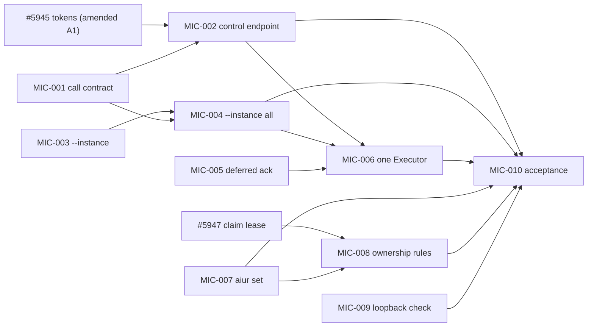

# Multi-instance control plane — planning pack

- **Feature slug:** `multi-instance-control` · **Display label:** Multi-instance control plane · **Ticket prefix:** MIC · **plan_version:** 1
- **Researched at:** `ab0c21424` (origin/main, 2026-10-23)
- **Plan:** [`../2026-10-23-001-feat-multi-instance-control-plan.md`](../2026-10-23-001-feat-multi-instance-control-plan.md)
- **Graph:** [`graph.json`](graph.json) · **Decisions:** [`questions-or-commands.md`](questions-or-commands.md) · **Deferred:** [`deferred-findings.md`](deferred-findings.md) · **Validation:** [`validation-report.md`](validation-report.md)
- **Status of this pack:** promoted 2026-10-23. Epic #5964 (sub-issue of #5841); amendments A1-A6 posted as comments on the existing tickets. The ticket documents in `tickets/` are frozen; GitHub owns ticket state from here.

## Issue index

| Pack id | Issue | Lane | Dispatch label | Blocked by |
|---|---|---|---|---|
| MIC-001 | #5965 | PC | `agent:todo` | — |
| MIC-002 | #5970 | PC | `agent:todo` | #5965, #5945 |
| MIC-003 | #5968 | NUC | `nuc:todo` | — |
| MIC-004 | #5972 | NUC | `nuc:parked` | #5965, #5968 |
| MIC-005 | #5966 | PC | `agent:todo` | — |
| MIC-006 | #5973 | PC | `agent:todo` | #5970, #5972, #5966 |
| MIC-007 | #5969 | NUC | `nuc:todo` | — |
| MIC-008 | #5971 | PC | `agent:todo` | #5947, #5969 |
| MIC-009 | #5967 | PC | `agent:todo` | — |
| MIC-010 | #5974 | PC | `agent:todo` | #5970, #5972, #5973, #5969, #5971, #5967 |

## Request

Operator, 2026-10-23, verbatim:

> "At the moment, I have to run an executor agent on each machine to manage each IR instance. As we're thinking about how we will support running IR on multiple machines with features like setting in the config which tickets will be owned by which IR instance, I'd like to also build this in such a way that a single agent from a single machine can update portions of the config in external machines. For example, having a single executor coordinate on instances running on different machines. I'm even wondering if we make the CLI support passing that command off externally."

Then: "do a deep research spike on this work. Use compound engineering skills like brainstorm and plan to write up tickets and deeply document all of the tickets in documentation before we add actual tickets at GitHub." ("IR" is dictation for Aiur.)

## Boundary and authority

- Planning only. Commit and push of this branch and a draft PR were authorized; the operator then authorized promotion, done on 2026-10-23 (see Issue index).
- Source precedence: operator decisions > this pack's decisions > GitHub (for existing tickets) > Aiur runtime > prose here.
- Finite boundary: R1-R20 in the plan. The run ends when #5974 merges with its evidence.
- Calibration: the operator gave no ticket-count estimate. The pack has 10 new tickets (26 points) plus 6 amendments to existing tickets, against 6 hypothesis pieces. The extra tickets come from splits that keep each PR independently green: the call validator apart from its HTTP route (security review on a pure module), the wake-ack server change apart from the client merge, and a loopback-distribution check that no existing ticket owns.

## Reconciliation with existing tickets

| Hypothesis piece | Owner after this plan | New or amend |
|---|---|---|
| 1. `aiur --instance <name> <cmd>`, registry | #5968, #5972 | new |
| 2. Control API with scoped tokens and audit | #5965, #5970 on top of #5945 | new + amend #5945 (A1) |
| 3. Remote config as validated, build-aware data | #5969 | new (extends existing `aiur set`) |
| 4. Ticket ownership as data | #5971 on top of #5947 | new + amend #5947 (A3) |
| 5. One Executor for all instances | #5966, #5973 | new |
| 6. Security | #5967; TLS at proxy stays #5942; tailnet sign-in stays #5611 | new + amend #5939/#5940 (A4) |
| Roster CLI overlap | #5950 | amend (A2) |
| Guide | #5954 | amend (A5) |

### Proposed amendments to existing tickets

Apply when promoting, as one comment on each existing ticket (the ticket owner folds it into the body); do not edit this file for them.

- **A1 — #5945:** split the hard block on #5942. Acceptance 1, 2, 4 and 5 (tokens, scopes, sending a token, docs) need no public sign-in and may merge first; only acceptance 3 (refuse basic auth beyond loopback) waits for #5942. Add: the bearer plug assigns `conn.assigns.token_name` and `conn.assigns.token_scope` and does not itself deny `POST /api/v1/control` to a read token (an exception to acceptance 2's "read-scope tokens cannot call write routes"); #5970 enforces scope per call. The `api_write` exemption (no cookies, so the Origin/`X-Aiur-Request` CSRF checks do not apply; `src/lib/aiur_web/routes/decisions.ex:12` shows the current requirement) applies to the control route only; other bearer routes keep #5945's own pipeline. Narrow acceptance 4 ("the engine's control calls send a bearer token") to the Stream Deck sidecar and the other dashboard machine clients named in its Problem; the engine's remote control sender (token file or env, header file, never argv) is owned by #5968. Without A1, the chain is #5611 → #5942 → #5945 → #5970, and the first remote slice waits on sign-in work it does not use.
- **A2 — #5950:** replace acceptance 3 (`aiur status --all-instances`) with "plain `aiur status` shows a roster section when a lease store is configured"; live per-instance detail is `aiur --instance all status` (#5972). Add each instance's `server.public_url` to the roster record so the operator can copy it into the registry.
- **A3 — #5947:** add an instance-level heartbeat, separate from per-ticket leases (an idle instance holds no lease but must still be seen as live): instance id, build version, timestamps, and an opaque versioned `metadata` map that #5947 stores and returns without interpreting. Add a list-live-instances read that fails closed when the store is unreachable. #5971 fills `metadata` with `owns`, `pool`, and `dispatching`; #5947 does not own those fields. The store choice stays #5947's recorded design decision (AC6); D3 (Postgres, reachable from home instances over TLS) is the recommended default, not an acceptance rule.
- **A4 — #5939 and #5940:** the container entrypoint exports the engine's loopback distribution flags and a cookie from the environment or volume, never the release's `releases/COOKIE`; #5967 makes a miss fail at boot.
- **A5 — #5954:** add "Control several instances from one machine" (registry, tokens, `--instance`, fleet Executor), written by #5974 if #5954 merges first. Also state that Erlang distribution is loopback-only on every instance and remote control uses HTTPS (#5967).
- **A6 — every Railway ticket that still has a `{Tn}` placeholder (#5940, #5941, #5943, #5944, #5945, #5946, #5948, #5949, #5950, #5951, #5954):** replace the placeholders with issue numbers: T1 = #5939, T2 = #5940, T3 = #5941, T4 = #5943, T6 = #5942, T9 = #5947 (DF-4). Apply after A1, so #5945's `{T6}` reads as the split block A1 describes, not a hard block on #5942. Post as a comment on each ticket; the ticket owner edits the body.

## Lanes

| Lane (epic column) | Icon | Tickets | Earliest phase |
|---|---|---|---|
| transport | `arrows-right-left` | #5965, #5970, #5968, #5972 | 1 |
| executor | `bolt` | #5966, #5973 | 1 |
| config-ownership | `adjustments-horizontal` | #5969, #5971 | 1 |
| safety-acceptance | `shield-check` | #5967, #5974 | 1 |

Machine lanes: PC owns #5965, 002, 005, 006, 008, 009, 010; NUC owns #5968, 004, 007 (balanced so both start in phase 1).

## Graph and waves

Hard dependencies (`depends_on`), from `graph.json`:

| Phase | Members (antichain) | Points | Kevin can try after |
|---|---|---|---|
| 1 | #5965, #5968, #5966, #5969, #5967 (+ #5945, #5947 already filed) | 13 | `aiur set agent.max_concurrent_builds 2`, `aiur set --list`; `aiur doctor` distribution line |
| 2 | #5970, #5972, #5971 | 8 | **`aiur --instance nuc status`**, `aiur --instance all agents`, `instance.owns` |
| 3 | #5973 | 3 | one Executor for PC and NUC |
| 4 | #5974 | 2 | full acceptance |

- **Depth:** 4 phases (budget 5).
- **Critical path:** #5945 → #5970 → #5973 → #5974, with #5965 parallel to #5945. Without amendment A1 it lengthens by #5611 (PR 5903) and #5942.
- **Spine (first-slot staffing):** #5945 and #5965 (both unblock #5970, the transport every remote feature uses), then #5968.
- **Same-phase serializations:** none. `serializes_with` edges point at in-flight tickets outside the pack: #5970 ~ #5942 (`router.ex`), #5968 ~ #5939 (`aiur-engine.sh`), #5971 ~ #5948/#5949 (lease record shape). `suggested_after`: #5967 after #5939/#5940 (container entrypoint flags, A4).
- **Hot file:** `website/docs-app/reference/cli.md` (500-line cap) is edited by seven tickets in different sections; recorded as an exception, not an edge. Each PR consolidates rows to stay at or under 500 lines.
- **Dropped data-flow edges** and the ticket that reconnects each: `graph.json` `integration_ledger` (all reconnected by #5974 or named merge order).

## Hypotheses the code changed

1. **"A control API that returns the same JSON envelopes as the CLI."** There is no shared envelope (`commands_cli.ex`, `github_cost_cli.ex`, `feature_cli.ex` each build their own) and most mutating commands print text only. Changed to: forward the CLI's own allowlisted call and return its output verbatim (KTD1). Parity is structural.
2. **"Every CLI control command over HTTPS."** `stop`, `restart`, run, `init`, `doctor`, `upgrade`, `cleanup-stale`, `pre-pr` are bash or local-BEAM and manage host processes; `listen` streams. About 45 RPC commands become remote; the rest are refused by name.
3. **"`~/.aiur/instances.yaml`."** `~/.aiur/instances/<key>/` already exists for dashboard secrets. Renamed `~/.aiur/remote-instances.yaml`.
4. **"New keys reaching an older build crash the orchestrator."** Not true at this commit: unknown keys are dropped silently (`schema.ex:202-214`), and since #3980 a rejected hot reload keeps the last good config. The 2026-10-10 crashes were invalid values of known keys on a build without #3980. Remaining risks are a silent no-op for an unknown key and a boot crash on an invalid file; #5969 validates at write time in the receiving build and never lets an override stop boot.
5. **"Ownership rules in the shared coordination store."** Changed to per-instance config published through #5947 heartbeats; the lease already guarantees one dispatcher.
6. **"`executor-wait --instance all` merges the streams."** Confirmed, with two prerequisites the hypothesis missed: the daemon acknowledges a batch before an HTTP reply is delivered (needs #5966), and `wake_id` is a per-journal counter, so records need their instance name and one cursor per instance.
7. **"Erlang distribution never leaves localhost."** True only on the bash engine path; the daemon's documented refusal is not implemented, and the release falls back to a baked cookie. New #5967.
8. **"Scoped tokens, read vs control."** #5945 already defines `read`/`write`; reuse those names.
9. **"`repo_global` services list."** No such key; it is `instance.role` read once at boot (`src/lib/aiur.ex:77-83`). #5948 owns making it dynamic.

## Discovery policy

P0/P1 acceptance blockers found during execution become tickets in this collection with `discovered_from`. Contained review findings return to the owning ticket. Everything else goes to `deferred-findings.md`. If created tickets outpace merged tickets by more than 3, stop creating and report.

## Executor handoff

1. Read the plan's Goal Capsule, this README, and `questions-or-commands.md`. Use `aiur-run`; write a three-to-five-sentence goal that names this collection, the stop condition (#5974 merged with evidence), and that promotion needs the operator's word.
2. On the operator's go-ahead, promote: apply amendments A1-A6 to the existing tickets; create #5965 to #5974 from `tickets/*.md` verbatim with `feature:multi-instance-control`, `priority:1`, the lane label (`agent:queued` for PC, the NUC prefix for NUC tickets), and `area:daemon`/`area:cli`/`area:ui` as fits; write native `blocked_by` links from `graph.json`; `aiur feature create multi-instance-control` and `aiur feature add`; enqueue. Read back with `aiur feature show multi-instance-control --json` and `aiur queue show --json`. Record the MIC → issue number map in this README and freeze the ticket documents.
3. Dispatch first: #5945 (after A1), #5965, #5968.
4. Fresh state comes from `gh issue list -R aiur-team/aiur --label feature:multi-instance-control` and `aiur agents`; nothing in this pack is live state.
5. Unresolved human gates: none blocking; D1-D13 proceed on defaults.
