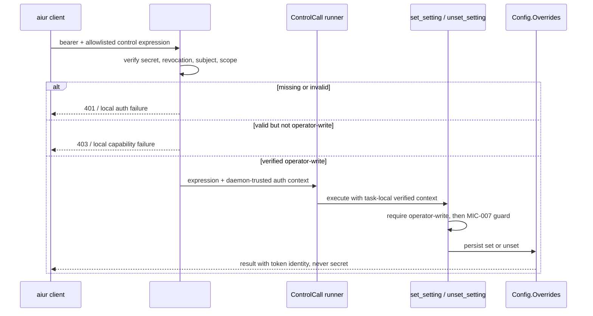

# Runtime Setting Operator Token Binding - Plan

## Goal Capsule

- **Objective:** Require a verified #5945 operator write credential for every runtime-setting mutation, including direct RPC calls, while preserving authenticated remote `aiur set` behavior.
- **Authority:** Issue #6075 defines the security outcome; #5945 owns bearer-token issuance and verification, #5965 owns the control-call boundary, and #5969 owns runtime-setting persistence and MIC-007 path evidence.
- **Stop conditions:** Do not invent a second token format, treat caller-supplied identity or path evidence as authentication, expose a write token to an agent environment, or persist any mutation before authorization succeeds.
- **Tail ownership:** Integration with the dependency contracts, regression and mutation tests, documentation, draft PR self-review, and CI handoff remain part of this ticket.

---

## Product Contract

### Summary

`set_setting` and `unset_setting` will mutate runtime overrides only within a control call authenticated as an operator holding a write-scope #5945 bearer token. Missing, invalid, revoked, read-only, and agent-scoped credentials fail before persistence. MIC-007 caller-path evidence remains a defense-in-depth guard, not the authorization boundary.

### Problem Frame

#5969 rejects setting mutations when its caller reports an agent-workspace path, but the path is an untrusted option in the generated Erlang RPC expression. A handcrafted direct RPC can omit or forge that evidence and reach `Aiur.Config.Overrides`. The remote control design authenticates HTTP calls, but endpoint-only authorization does not protect an exported mutation function from local distribution RPC. The persistence boundary therefore needs proof derived from #5945's token verifier, and agent processes must remain unable to acquire that proof.

### Requirements

- R1. `set_setting`, `unset_setting`, and every exported runtime-override write entry point require a currently valid #5945 bearer credential whose trusted subject is an operator and whose effective scope permits writes.
- R2. Missing, malformed, unknown, revoked, expired, read-only, or agent-scoped credentials are refused before `Aiur.Config.Overrides.set/3`, `unset/2`, or any replacement persistence function writes state.
- R3. A caller cannot authorize a mutation by supplying an actor string, scope atom, principal-shaped map, token name, or empty/operator-like caller-workspace path.
- R4. The authenticated remote `aiur --instance <name> set ...` path continues to work and records the verified token identity as the mutation actor without storing or rendering bearer material.
- R5. Agent processes and agent-workspace shells do not inherit the write token, its source path, or a reusable derived credential; existing `AIUR_TOKEN_*` scrubbing covers the exact credential source selected by #5945.
- R6. Read-only settings listing keeps #5945's read policy and does not gain a write-token requirement.

### Scope Boundaries

- Keep MIC-007 caller-path validation as cooperative defense in depth; this ticket does not replace or broaden its workspace discovery logic.
- Reuse #5945's token storage, verification, revocation, subject, and scope vocabulary. Do not add a setting-specific token store or a third scope.
- Do not redesign the general control-call allowlist, control endpoint, or runtime-overrides file format beyond the authorization context needed by setting mutations.
- Do not change which setting keys #5969 allows or when their values take effect.

### Acceptance Examples

- AE1. Given no credential and an empty caller-workspace path, a direct `set_setting` RPC returns an authorization failure and the overrides list remains unchanged.
- AE2. Given a forged actor, write-scope label, or operator-like path but no valid bearer, both the CLI wrappers and direct `Aiur.Config.Overrides.set/3` or `unset/2` calls fail without touching the existing override.
- AE3. Given valid read-only, agent-scoped, revoked, or malformed credentials, mutation fails before persistence and does not reveal whether the setting value would pass schema validation.
- AE4. Given a valid operator write token through the authenticated control transport, remote set and unset succeed, and provenance records only the verified token identity.
- AE5. Given an agent environment assembled for any supported harness or contributor, the exact write-token environment name and any canonical token-file variable are absent, while an operator shell outside a workspace can still supply the credential.
- AE6. Given a credential allowed to read settings but not write them, `set --list` follows #5945's read policy and mutation remains denied.

---

## Planning Contract

### Key Technical Decisions

- KTD1. Authorize at the deepest exported mutation boundary as well as at the network edge. `Aiur.Config.Overrides.set/3` and `unset/2` must require trusted authorization before validating or writing state, while `set_setting` and `unset_setting` refuse before parsing caller values. Endpoint-only, launcher-only, or wrapper-only checks are insufficient because `bin/aiur rpc` evaluates caller-supplied release expressions and can invoke the exported overrides module directly.
- KTD2. The trusted context is created only by #5945's canonical bearer verifier from the presented secret. Caller-supplied actors, names, scopes, maps, and MIC-007 path evidence are never promoted into authorization. If the verifier's result is an ordinary forgeable term, the mutation boundary revalidates the bearer or consumes a daemon-owned opaque capability rather than trusting the term alone.
- KTD3. Carry authentication outside the user-controlled control expression. The remote controller verifies the Authorization header before parsing or running the call, and the control runner installs only the verified identity and effective scope for the task that executes the mutation. A local operator mutation must use the same #5945 client credential resolver and authenticated ingress, or another #5945-owned side channel that never serializes the bearer into audit output, override provenance, error text, or agent-visible command templates.
- KTD4. Require the conjunction of verified operator subject and effective write scope. A generic write scope held by an agent-scoped credential is not sufficient, and a verified operator read token cannot mutate.
- KTD5. Preserve MIC-007 after credential authorization as a second refusal reason. Authentication closes the forged-path bypass; the path guard continues to stop accidental mutation attempts launched from known agent workspaces even if surrounding operator tooling is misconfigured.
- KTD6. Fail closed before validation or persistence and return the transport's established semantics: missing or invalid credentials are unauthenticated, valid credentials without the required capability are forbidden, and local control output reports one named nonzero application failure. Credential detail is never echoed.

### High-Level Technical Design

The diagram is a boundary contract, not a prescription for #5945's final module names. The implementation must use the dependency's shipped verifier and principal types rather than reproducing them.

### Assumptions

- #5945 will expose daemon-side bearer verification that returns a trusted token identity, subject/client class, revocation state, and effective `read` or `write` scope. This ticket adapts to that shipped API; it does not infer trust from `Aiur.ControlCall.actor/0`.
- #5965's control-call runner and #5969's runtime-settings modules are prerequisites. Their actual validated refs must be consumed only after the corresponding dependency is explicitly unblocked or merged.
- #5945's operator client resolver defines the canonical token environment or file source. The exact source must be added to the agent-environment scrub tests; this plan does not predeclare a competing variable name.
- Bearer material is transient request data. It must not enter the overrides file, actor field, audit expression, structured error, log message, or test failure output.

### System-Wide Impact

- **Trust boundary:** Authorization moves from cooperative launcher evidence to a daemon-verified secret at the exported persistence boundary. HTTP and CLI-wrapper authentication remain early rejection and audit sources, not the sole guards.
- **Control execution:** The control runner needs task-local verified auth context that survives its task/group-leader boundary and is cleared with the task. Other control calls retain their current behavior.
- **Launcher parity:** Local and remote setting mutations must resolve credentials through #5945 and reach the same authorization contract. `set --list` remains separately classified as read.
- **Credential isolation:** `Aiur.AgentEnvironment` and contributor environments must scrub every canonical #5945 write-token source. Tests must cover Codex, Claude, and generic contributor assembly rather than only one launcher fixture.
- **Persistence and audit:** Denied calls cannot change the override revision, file contents, reload stamp, or actor history. Successful provenance stores the verified token name/identifier, never the bearer.
- **Failure behavior:** Authentication runs before value/schema validation so unauthorized callers cannot probe setting validity and every denial is side-effect free.

### Risks & Dependencies

- **#5945 is not yet implemented.** The credential verifier, subject model, and canonical client source are unavailable. Mitigation: declare #5945 as a blocker, prepare only integration-neutral tests/plan work, and adopt its actual API after an explicit `unblocked` signal.
- **#5945's current issue contract names only `read` and `write`, not an operator/agent client class.** Its consumable verifier must return a trusted operator-write capability or equivalent issuance audience. If it lands without one, this ticket must extend the canonical token record and verifier; it must never infer operator status from a token name, caller path, or actor string.
- **#5969 is not on `main`.** The target mutation functions and MIC-007 tests live on its open branch. Mitigation: do not duplicate them; integrate the validated direct-blocker ref or merged base before implementation.
- **A forgeable principal reopens the bypass.** Mitigation: verify the bearer at the boundary or use a daemon-owned opaque capability whose authenticity is checked; test forged maps, actors, scopes, and paths.
- **A wrapper-only check leaves `Overrides` callable through raw release RPC.** Mitigation: enforce the same operator-write context inside every exported override writer and include direct writer calls in the regression suite.
- **Bearer leakage through control expressions, argv, or audit data.** Mitigation: keep the secret in #5945's transport/auth channel and assert sentinel token material is absent from output, audit, overrides, and launcher templates.
- **Agent credential exposure through a new source name.** Mitigation: inventory the final #5945 resolver and extend both positive operator tests and negative agent-environment tests for every accepted source.

### Sources & Research

- Issue #6075 supplies R1-R6 and the explicit direct-RPC threat model.
- `origin/aiur/5969-mic-007-runtime-settings` supplies `src/lib/aiur/control_cli/settings.ex`, its persistence order, the launcher expressions, and the cooperative path-evidence tests.
- `packaging/npm/aiur-cli/libexec/engine/control.sh` shows that local control uses Elixir `--rpc-eval`; the security boundary therefore cannot stop at an exported CLI wrapper.
- `origin/aiur/5965-mic-001-control-call` supplies `Aiur.ControlCall`, its task-local actor channel, and the literal-only allowlist contract.
- `origin/plan/multi-instance-control` defines the authenticated control endpoint, `read`/`write` scope model, remote setting flow, and token-derived actor provenance.
- `src/lib/aiur/agent_environment.ex` and `src/lib/aiur/agent_environment/credential_scrub.ex` already remove `AIUR_TOKEN_*` from agent environments.
- [RFC 6750](https://www.rfc-editor.org/rfc/rfc6750.html) grounds bearer protection and the 401-invalid / 403-insufficient-scope distinction.

---

## Implementation Units

### U1. Bind setting mutations to verified operator-write context

- **Goal:** Make every exported runtime-settings persistence entry reject calls that lack a currently verified operator write credential.
- **Requirements:** R1, R2, R3; AE1, AE2, AE3.
- **Dependencies:** #5945 verifier contract, #5965 control runner, #5969 settings implementation.
- **Files:** `src/lib/aiur/control_cli/settings.ex`, `src/lib/aiur/config/overrides.ex`, the #5945 verifier/principal module selected by its implementation, `src/lib/aiur/control_call.ex`, `src/lib/aiur/control_call/allowlist.ex`, `src/test/aiur/control_cli/settings_test.exs`, `src/test/aiur/config/overrides_test.exs`, and focused #5945/control-call tests adjacent to their shipped modules.
- **Approach:** Install verified authentication only after #5945 accepts the presented bearer, carry it into the exact task that executes `ControlCall.run`, and require operator plus effective write scope in both the CLI mutation wrapper and the exported override writer. Keep MIC-007 in the wrapper immediately after authorization. Do not accept a caller-authored authorization option or derive capability from the actor string.
- **Patterns to follow:** `Aiur.ControlCall` task-local actor propagation for lifecycle shape, #5945's canonical verifier for trust, and `Aiur.Config.Overrides` tests for side-effect assertions.
- **Test scenarios:** Missing credential with empty path fails; forged operator actor/scope/principal/path fails; direct RPC-shaped calls to `Overrides.set/3` and `unset/2` fail without verified context; malformed, revoked, expired, read-only, and agent-scoped credentials fail; each denial leaves list, file contents, revision, and existing values unchanged; invalid setting/value details are not exposed before auth; a verified operator write context sets and unsets successfully.
- **Verification:** The focused settings test observes the real persistence store, and mutation testing proves the direct-RPC regression test passes only with the production authorization check present.

### U2. Preserve authenticated local and remote CLI behavior

- **Goal:** Route operator `aiur set` mutations through the canonical #5945 credential path without leaking bearer material or weakening read-only listing.
- **Requirements:** R4, R6; AE4, AE6.
- **Dependencies:** U1 and the authenticated control endpoint/client contracts built on #5945.
- **Files:** `packaging/npm/aiur-cli/libexec/engine/commands.sh`, `packaging/npm/aiur-cli/libexec/engine/remote.sh`, the #5945 client credential resolver, `packaging/npm/aiur-cli/test/launcher-control.test.mjs`, `packaging/npm/aiur-cli/test/launcher-remote.test.mjs`, and `src/test/aiur_web/controllers/control_controller_test.exs` when that dependency owns the ingress fixture.
- **Approach:** Resolve the operator token exactly once using #5945's client API, present it only through its authenticated transport, and preserve remote `max_scope` enforcement. Keep `set --list` on the read path. Ensure generated expressions and diagnostics contain no raw token.
- **Patterns to follow:** The existing remote registry's token reference resolution, control-result marker handling, and controller 401/403 error envelopes.
- **Test scenarios:** Remote write token set/unset succeeds with token identity provenance; read token mutation returns forbidden without a network retry or fallback; missing/revoked token is unauthenticated; `set --list` works under the shipped read policy; sentinel bearer bytes are absent from generated expressions, stdout/stderr, audit records, and persisted overrides.
- **Verification:** Bun launcher tests exercise the generated client request, and controller tests exercise the real verifier plus mutation rather than injecting final authorization state.

### U3. Prove write credentials stay outside agent environments

- **Goal:** Prevent agents and agent-workspace shells from inheriting any reusable #5945 write credential.
- **Requirements:** R5; AE5.
- **Dependencies:** #5945's final credential-source contract and U2.
- **Files:** `src/lib/aiur/agent_environment.ex`, `src/lib/aiur/agent_environment/credential_scrub.ex`, `src/lib/aiur/agent_environment/contributor.ex`, `src/test/aiur/agent_environment/remote_instance_token_scrub_test.exs`, `src/test/aiur/agent_environment/contributor_test.exs`, and any #5945 token-resolver tests.
- **Approach:** Inventory every environment name and file-reference variable the operator client accepts. Scrub them from all agent environment builders while leaving unrelated operator processes unchanged. Do not copy token contents or token file paths into runtime prompts, workspace files, or child metadata.
- **Patterns to follow:** Existing `AIUR_TOKEN_*` deny-pattern tests and contributor environment assembly tests.
- **Test scenarios:** Each canonical write-token source is present in the parent fixture but absent from Codex, Claude, and contributor child environments; similarly named non-token variables are not over-scrubbed; an agent direct RPC with forged path evidence still fails; an operator process outside the agent builder can resolve the token and complete U2.
- **Verification:** Environment tests assert exact absence of both value and source reference, and the end-to-end direct-RPC regression demonstrates that isolation plus server authorization closes the bypass.

### U4. Document the authenticated mutation contract

- **Goal:** Keep operator guidance accurate for local and remote settings without duplicating #5945's token-management documentation.
- **Requirements:** R1, R4, R5, R6.
- **Dependencies:** U1-U3.
- **Files:** `website/docs-app/reference/cli.md` or its size-preserving owning page, and the #5945 authentication page selected by that ticket.
- **Approach:** State that set/unset require an operator write token, list follows read policy, write tokens must stay in operator-only environment storage, and agent workspaces do not inherit them. Link to the canonical token creation/storage guidance rather than restating it.
- **Test scenarios:** Documentation checker recognizes the final CLI surface; examples name token references but never literal secrets.
- **Verification:** CLI reference checks pass and the page remains within its 500-line cap.

---

## Verification Contract

- From `src/`, `mise exec -- mix compile --warnings-as-errors` passes and `mise exec -- mix format` leaves the touched Elixir files formatted.
- From `src/`, `mise exec -- mix aiur.affected_tests` identifies the scoped test set; every reported invocation passes with `mix test --max-cases 4`.
- From `packaging/npm/aiur-cli/`, focused `bun test` runs name and pass the touched launcher test files.
- Focused tests prove 401-style invalid/missing and 403-style insufficient/agent-scoped refusals before persistence, successful authenticated remote mutation, unchanged read listing, and credential scrubbing.
- In an isolated worktree, each new regression test fails with its guarding production authorization/scrub hunk reverted and passes after restoration; the exact commands and results are recorded in the PR body.
- Repository handoff gates pass: `mise exec -- mix lint`, `python3 scripts/check-bare-assert-receive.py`, the structural gate against `origin/main`, `aiur pre-pr`, and `scripts/pre-handoff-guards` with fresh PR metadata.
- Manual-only acceptance is recorded in the PR body, not claimed as run here: `Post-deploy check: create an operator write token, run remote aiur set and unset against a live instance, confirm the value changes, then repeat with missing, read-only, and agent-scoped tokens and confirm no override revision changes (operator: human with access to the live instance and token store).`

---

## Definition of Done

- R1-R6 and AE1-AE6 have executing regression coverage against the real verifier and persistence store.
- No mutation path, including handcrafted direct RPC to the CLI wrapper or exported overrides writer with forged path/actor evidence, reaches persistence without a valid operator write credential.
- Local and remote authenticated operator mutation remain functional; read-only listing retains #5945's read policy.
- Agent and contributor environments exclude every canonical reusable write-token source.
- Bearer material is absent from control expressions, logs, audit records, errors, prompts, override files, and provenance.
- MIC-007 remains active as defense in depth, documentation ships in the same PR, and no temporary compatibility bypass remains.
