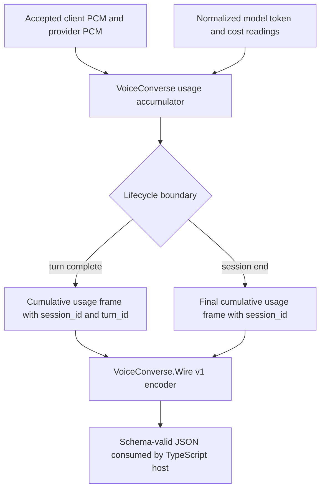

# Voice Usage Wire Frames - Plan

## Goal Capsule

**Objective.** Give an embedding host cumulative voice-session usage on the public `VoiceConverse.Wire` stream at every completed turn and at session termination.

**Authority.** GitHub issue #5687 and its 2026-10-23 consumer-packaging requirements define the product contract.
The v1 wire codec, schemas, and golden-fixture layout owned by #4091 define the integration contract.

**Stop conditions.** Do not introduce a parallel wire codec, schema family, or fixture layout while #4091 is unavailable.
Stop integration if the delivered #4091 frame/version contract cannot represent an additive server-to-client usage frame without a breaking v1 change.

**Execution profile.** Build the usage accumulator independently, then extend the real #4091 contract and session lifecycle after its validated branch is explicitly unblocked.
The ticket remains blocked from a ready PR until all three implementation units are integrated and verified.

---

## Product Contract

### Summary

An embedding host receives one versioned usage snapshot when each assistant turn completes and one final snapshot when the voice session ends.
Each snapshot identifies the voice session and reports model tokens, input and output audio duration, and estimated cost.
The JSON Schema and golden fixtures generate the TypeScript type consumed outside this repository.

### Problem Frame

Voice usage is currently available only through internal telemetry and harness-specific maps.
That does not let a host attribute voice cost to its own job or account, and it gives a TypeScript consumer no stable contract to generate against.

### Requirements

**Wire behavior**

- R1. The server-to-client v1 wire contract includes an additive `usage` frame carrying the existing opaque voice-session identifier; the frame does not add host account, credential, or tenant identifiers.
- R2. The session emits a cumulative snapshot once at each turn-complete boundary and once immediately before its terminal `ended` frame.
- R3. The session-end snapshot includes the last turn's usage without double-counting data already reported at turn end.

**Usage semantics**

- R4. Every snapshot carries cumulative model input, output, and total tokens when the source reports them; each unavailable token dimension remains independently unknown.
- R5. Every snapshot carries cumulative input and output audio seconds derived from PCM duration rather than wall-clock session time.
- R6. Every snapshot carries cumulative estimated USD cost when a source reports it, while unavailable tokens or cost remain unknown rather than becoming zero.

**Consumer packaging**

- R7. The usage frame has draft 2020-12 JSON Schema coverage and golden fixtures in the package and naming layout established by #4091.
- R8. Generated `@aiur/contracts` exports include the usage-frame TypeScript type without adding a runtime dependency to `voice_converse`.
- R9. A test validates real `VoiceConverse.Wire.encode/1` output against the schema and fails when the encoder alone adds, removes, or renames a required field.
- R10. V1 accepts additive fields, while a future breaking shape lands as v2 beside v1.

### Acceptance Examples

- AE1. After turn `turn-7` completes, the client receives a `usage` frame for session `voice-123` whose cumulative totals include that turn and whose boundary identifies the turn.
- AE2. When session `voice-123` ends, the client receives one final cumulative `usage` frame before `ended`, even when no model provider cost was available.
- AE3. When no model token or cost source has reported a value, those readings remain explicitly unknown while known zero audio duration stays numeric zero.
- AE4. If the encoder renames `session_id` without changing the schema, the schema-backed encoder test fails.

### Scope Boundaries

In scope: the reusable core accumulator, the #4091 v1 server-frame extension, contract package generation, and session-boundary emission.

Out of scope: package publication and release tags owned by #5936, pricing-table changes, host billing policy, dashboard rendering, and telemetry persistence.

---

## Planning Contract

### Key Technical Decisions

- KTD1. Frames are cumulative snapshots, not deltas.
  A host can reconnect or miss an intermediate turn frame without permanently losing the session total, and repeated snapshots do not require additive replay.
- KTD2. The frame distinguishes `turn` and `session` boundaries and includes `turn_id` only for the turn boundary.
  This makes duplicate suppression and final-attribution checks possible without inventing a second frame type.
- KTD3. Unknown is distinct from zero for model tokens and estimated cost.
  The package does not fabricate provider readings or infer missing token dimensions, while audio seconds remain known from transported PCM bytes.
- KTD4. Audio accounting uses decoded PCM byte counts and each direction's declared sample rate.
  The package contract defines audio as 16-bit little-endian mono PCM, so duration is `bytes / (sample_rate * 2)`.
  Wall time includes silence, reconnects, and thinking time and therefore cannot represent audio consumed or produced.
- KTD5. The usage variant extends the server-frame v1 schema and generated union delivered by #4091.
  It does not create a competing schema namespace or copy blocker-owned files.
- KTD6. The terminal usage frame is encoded and sent before `ended`.
  A consumer can finalize attribution from the same ordered stream before closing the session.

### High-Level Technical Design

### Assumptions

- #4091 will establish a `v: 1` marker, server-frame union, and shared schema/fixture naming under `packages/aiur-contracts/` as required by its accepted packaging criteria.
- The session lifecycle delivered by #4091 exposes one authoritative turn-complete transition and one ordered terminal-send path.
- Provider adapters may omit model token or cost readings; absence is a coverage state, not a measured zero.
- Model-usage inputs to the accumulator are per-operation deltas. An adapter receiving an absolute provider counter must first convert it to a non-negative delta and submit it exactly once.
- The usage frame travels over #4091's existing authenticated session transport and carries only its opaque core session identifier; the host keeps any job/account mapping outside the wire frame.

### Risks and Dependencies

- #4091 is a native blocker because `VoiceConverse.Wire`, the transport-neutral session API, and the voice schema/fixture files do not exist on `main`.
- Audio output can change sample rate between chunks, so duration must be accumulated per chunk rather than inferred from a session-wide format.
- A terminal path may be triggered by user end, provider error, transport loss, or timeout; all paths must pass through one final-snapshot guard to prevent omission or duplication.

---

## Implementation Units

### U1. Add a host-neutral session usage accumulator

**Goal.** Accumulate normalized token, audio-duration, and estimated-cost readings without depending on the wire codec or the Aiur host application.

**Requirements.** R4, R5, R6.

**Dependencies.** None.

**Files.**

- `packages/elixir/voice_converse/lib/voice_converse/usage.ex`
- `packages/elixir/voice_converse/test/voice_converse/usage_test.exs`

**Approach.** Keep the voice session identifier with monotonic cumulative counters.
Accept per-operation model-usage deltas from providers or forks, preserving each missing token dimension independently; callers must normalize absolute provider counters before this boundary.
Derive each audio chunk's duration from decoded 16-bit mono PCM bytes and format, and expose totals without wire-specific keys.
Reject negative counters and invalid audio while preserving an existing valid total.

**Execution note.** Start with behavior tests that prove unknown-versus-zero semantics and multi-rate audio accumulation before adding the accumulator.

**Patterns to follow.** `VoiceConverse.Events.AgentAudio` format values and the package's small pure modules with colocated tests.

**Test scenarios.**

- A new session exposes its identifier, zero known audio seconds, and unknown model tokens and cost.
- Two normalized model-usage deltas accumulate input, output, total tokens, and estimated cost monotonically without double-counting.
- A reading with only total tokens leaves input and output tokens unknown rather than inventing a split.
- Input PCM at 16 kHz and output chunks at 16 kHz and 24 kHz produce the expected cumulative durations.
- Invalid base64, an unsupported format, or a negative model reading returns an error and leaves the prior accumulator usable.
- An explicitly reported zero token/cost reading becomes known zero rather than remaining unknown.

**Verification.** The accumulator's tests pass in the standalone `voice_converse` package and `scripts/check-voice-converse-isolation.sh` still reports no host reference.

### U2. Extend the v1 wire and TypeScript contract

**Goal.** Add the server-to-client usage variant to the codec, schema, fixtures, and generated TypeScript union established by #4091.

**Requirements.** R1, R7, R8, R9, R10, AE4.

**Dependencies.** #4091 and U1.

**Files.**

- `packages/elixir/voice_converse/lib/voice_converse/wire.ex`
- `packages/elixir/voice_converse/test/voice_converse/wire_test.exs`
- `packages/aiur-contracts/schemas/`
- `packages/aiur-contracts/fixtures/`
- `packages/aiur-contracts/scripts/generate.mjs`
- `packages/aiur-contracts/scripts/validate.mjs`
- `packages/aiur-contracts/scripts/check-fixture-types.mjs`
- `packages/aiur-contracts/test/`
- `packages/aiur-contracts/src/`
- `packages/aiur-contracts/README.md`

**Approach.** Add one usage variant to the upstream server-frame v1 union with `additionalProperties: true` at additive boundaries.
Require the v1 marker, frame type, session identifier, boundary, audio totals, and presence of token/cost readings even when their values are unknown.
Generate the TypeScript type from that schema and keep turn-boundary and session-boundary golden examples in the shared fixture set.

**Execution note.** Add the schema-backed encoder test first and prove it fails when the encoder-only `session_id` field is renamed.

**Patterns to follow.** The #4091 voice schemas and fixtures after integration, plus `packages/aiur-contracts/scripts/validate.mjs` and `test/status-contracts.test.mjs` for draft 2020-12 validation and additive-v1 behavior.

**Test scenarios.**

- Turn and session golden frames encode through `VoiceConverse.Wire` and validate against the v1 server-frame schema.
- Removing `session_id`, changing `v`, or using an unsupported boundary is invalid.
- A turn boundary without `turn_id` is invalid, while a session boundary does not require it.
- Unknown model tokens and cost remain schema-valid; negative counts, seconds, or cost are invalid.
- An additive future field remains valid in v1.
- The generated TypeScript fixture probe accepts both golden variants and exports the public usage type.

**Verification.** The codec golden test, schema validation, generated-type drift check, fixture type-check, and contract package tests all pass from clean package roots.

### U3. Emit snapshots at every lifecycle boundary

**Goal.** Feed the accumulator from the session and publish ordered usage frames at turn completion and session termination.

**Requirements.** R2, R3, R4, R5, R6, AE1, AE2, AE3.

**Dependencies.** #4091, U1, U2.

**Files.**

- `packages/elixir/voice_converse/lib/voice_converse/session.ex`
- `packages/elixir/voice_converse/test/voice_converse/session_test.exs`
- `packages/elixir/voice_converse/test/voice_converse/wire_test.exs`

**Approach.** Record accepted client audio, normalized provider audio, and model usage into the session accumulator.
At the single turn-complete transition, send a cumulative turn snapshot after the final turn content.
At the terminal transition, use a one-shot guard to send the final cumulative snapshot before `ended` for every end reason.

**Test scenarios.**

- One completed turn emits exactly one usage frame after its final content and includes that turn's readings.
- Two turns emit increasing cumulative snapshots rather than per-turn deltas.
- A normal end emits one final snapshot before `ended` without recounting the last turn.
- Provider error, idle timeout, and transport-loss termination each emit the same one-shot final snapshot ordering.
- A text-only session reports zero known audio duration and preserves unknown provider token/cost readings.

**Verification.** Session tests assert the exact ordered subscriber event stream and the encoded usage frames pass the shared schema.

---

## Verification Contract

- Run package format, warnings-as-errors compile, and focused U1/U2/U3 tests from `packages/elixir/voice_converse/`.
- Run `scripts/check-voice-converse-isolation.sh` to prove the core still has no Aiur host dependency.
- Run `npm run generate -- --check`, schema/fixture checks, TypeScript type-check, and Node tests in `packages/aiur-contracts/`.
- Run the repository affected-test selector after integration and every required root/source lint and structure guard before handoff.
- For each new behavioral test, verify it fails with its guarded production hunk reverted in an isolated, uniquely named worktree and passes when restored.

---

## Definition of Done

- U1 exposes tested cumulative usage semantics with unknown readings distinct from measured zero.
- U2 publishes a schema-valid, TypeScript-generated v1 usage-frame contract using the real #4091 codec and fixtures.
- U3 emits exactly one cumulative frame at each required boundary and preserves terminal ordering for every session end path.
- Standalone package isolation, contract generation, focused tests, lint, and repository guards pass.
- The PR documents the mutation result for every new behavioral test and contains no temporary stub or abandoned blocker workaround.
