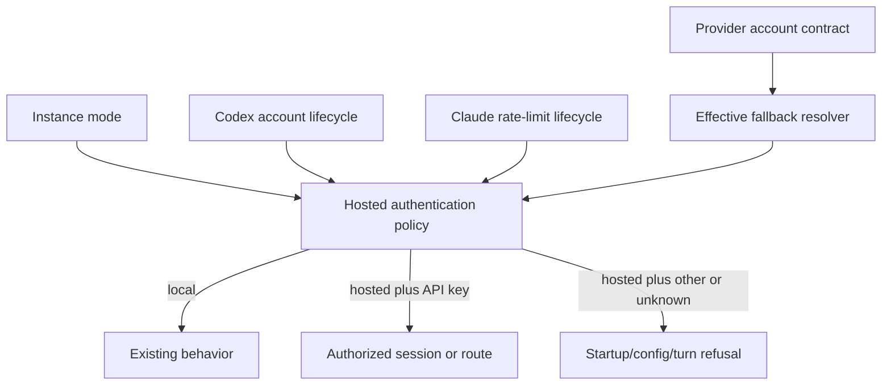
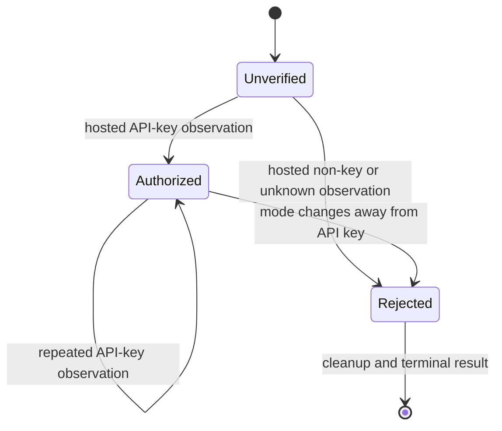

# Hosted API-Key Authentication Profiles - Plan

## Goal Capsule

- **Objective:** Make `instance.mode: hosted` authorize provider-backed agent work only after Aiur has established API-key authentication, and prevent usage-limit fallback from selecting a backend whose authentication is not statically API-key-only.
- **Authority:** Issue #5700 defines API-key-only hosted behavior. The hosted-mode boundary from issue #5699 and PR #6079 is the implementation prerequisite. Existing local-mode behavior remains authoritative outside hosted mode.
- **Execution profile:** Security-sensitive daemon work across semantic config validation and the Claude/Codex app-server lifecycle.
- **Stop conditions:** Do not weaken #5699's permission, network, or daemon-credential checks. Do not permit an unknown authentication mode. Do not infer safety from a profile name, directory, environment-variable presence, or a previous observation.
- **Tail ownership:** The implementation owns focused regression tests, documentation, mutation checks for every new test, the required Aiur local gates, and exact post-deploy CLI/TUI checks in the PR body.

---

## Product Contract

### Summary

Hosted execution will add a shared fail-closed authentication policy to the existing hosted-mode guard and to the Claude/Codex account-generation observations. API-key-only backends remain eligible as fallback targets; mixed, subscription, OAuth, personal-token, and unknown targets do not. This change does not upgrade any backend's separate permission, network, transport, or daemon-credential capability, so #5699 may still reject a production backend after its authentication rule passes.

### Problem Frame

Aiur already learns Claude and Codex authentication modes from trusted app-server lifecycle messages, but those observations currently update account-generation and meter state without controlling execution. A hosted deployment can therefore start or continue a turn with a subscription or OAuth profile.

The effective usage-limit fallback also defaults to Claude. In hosted mode that can move a job from an API-key route onto a mixed-authentication profile backend, bypassing the deployment boundary even if the primary route was safe.

### Requirements

**Runtime authentication**

- R1. Local mode preserves every currently supported Claude and Codex authentication mode and does not invoke hosted-only policy work.
- R2. Hosted mode accepts only the canonical API-key observation for the provider being used.
- R3. Hosted mode rejects subscription, OAuth, personal-token, header-derived, agent-identity, Bedrock, malformed, missing, and otherwise unknown authentication observations.
- R4. A rejected startup observation prevents the session from being returned as usable and runs the existing startup cleanup for account-generation state and the provider process.
- R5. A rejected mid-session observation or an authentication-mode transition terminates the active turn before Aiur executes any provider tool call or reports successful completion.
- R6. Hosted execution remains unauthorized until the current session has a trusted API-key observation; an actionable notification arriving first fails closed.
- R7. Rejection output may name the provider and normalized authentication class, but never the account name, profile path, credential value, raw lifecycle payload, or token-shaped data.

**Fallback routing**

- R8. Hosted semantic validation evaluates the effective usage-limit fallback after resolving `agent.priority` and the legacy `agent.rate_limit_fallback` setting.
- R9. A disabled fallback is valid, and a fallback is valid only when its registry account contract is statically API-key-only.
- R10. The default Claude fallback and every missing, mixed, or unknown fallback target make hosted configuration invalid before dispatch.
- R11. The same fallback configuration remains valid in local mode.

**Operations and compatibility**

- R12. A hosted authentication refusal is a typed terminal policy failure: it produces durable operator-visible evidence and does not automatically retry the same unsafe profile.
- R13. Existing account-generation and provider-meter continuity remains intact for accepted API-key sessions.
- R14. Existing hosted-mode documentation states the runtime authentication and fallback rules, including the fact that the local default fallback must be disabled or replaced in hosted mode.
- R15. Provider capabilities remain truthful: passing the authentication rule never overrides a separate #5699 permission, network, transport, or credential-boundary violation.

### Acceptance Examples

- AE1. Given local mode and a Codex ChatGPT login, starting and running a session behaves as it does today.
- AE2. Given hosted mode and a Codex `apikey` account observation, startup succeeds and later API-key rate-limit observations retain the same trusted generation.
- AE3. Given hosted mode and a Codex `chatgpt`, `chatgptAuthTokens`, or unknown account observation, startup returns a hosted-authentication error and the app-server process plus account binding are cleaned up.
- AE4. Given hosted mode and a Claude API-key rate-limit observation before any actionable event, the turn proceeds normally.
- AE5. Given hosted mode and a Claude subscription or unknown observation, the current turn ends with a redacted hosted-authentication error and no later fake tool call is executed.
- AE6. Given a hosted Claude or Codex session that was authorized by API key, a later observation of a disallowed mode ends the active turn instead of replacing the trusted generation and continuing.
- AE7. Given hosted mode with the default fallback, semantic validation names Claude as a non-API-key-only fallback. Setting the fallback to empty or to a registry-declared API-key-only target resolves that violation.
- AE8. Given the same default fallback in local mode, validation remains successful.
- AE9. Given a hosted runtime authentication refusal, the runner records one terminal policy failure and the retry engine does not launch the same unsafe profile again.

### Scope Boundaries

#### Deferred to Follow-Up Work

- Daemon-owned model-call credentials, per-job model tokens, remote workers, and sandbox VM delivery remain owned by issues #5701, #5702, #5703, and #5953.
- Creating or logging into Claude/Codex profiles remains an operator workflow; this change classifies and enforces what the trusted provider lifecycle reports.

#### Outside This Change

- Do not change the local default from Claude, rename existing config keys, or add a second hosted/consumer mode.
- Do not inspect provider credential files directly or treat environment-variable presence as proof of the authentication actually used.
- Do not modify same-provider Claude REPL account handoff; #5699 already excludes the REPL transport from hosted mode.
- Do not loosen the permission, network, transport, environment-contributor, or daemon credential boundaries introduced by #5699.
- Do not mark Claude, Codex, or an OpenAI-compatible backend fully hosted-safe in the registry unless its independent #5699 boundaries have been implemented and verified by their owning tickets.

### Dependencies

- Issue #5699 / PR #6079 must land first because it supplies `instance.mode`, `Aiur.Orchestrator.HostedModeCheck`, registry hosted-execution facts, and the shared boot/dispatch semantic gate.
- Issues #3478 and #3480 are not implementation blockers. The accepted #5699 plan records the physical harness package move as a no-go and retains the logical registry seam used here.

---

## Planning Contract

### Key Technical Decisions

- KTD1. Put authentication classification in one pure hosted-auth policy and call it from provider lifecycle adapters plus hosted fallback validation. This keeps provider wire spellings at their adapters while preventing Claude, Codex, and config validation from drifting on the meaning of API-key-only.
- KTD2. Enforce the current observation, not profile metadata. Profile names and directories do not prove which credential the CLI selected, while the trusted app-server lifecycle is already the account-generation authority.
- KTD3. Keep mixed-auth backends usable as primary hosted routes only when their runtime adapter proves API-key use. Automatic fallback is stricter because it has no trusted pre-dispatch observation: only a registry contract with API-key-only account kind and authentication modes is eligible.
- KTD4. Propagate policy rejection through existing startup and turn-loop return values, then preserve a typed terminal-policy classification through runner completion. Reuse provider cleanup and the orchestrator's durable failure evidence while adding the narrow non-retry disposition this security boundary requires.
- KTD5. Validate the effective fallback, not only the deprecated raw key. `agent.priority` can determine a different fallback and must pass through the same pure resolution used by runtime routing.

### High-Level Technical Design

The diagrams are directional. The implementation should preserve existing adapter and semantic-check boundaries rather than copy exact names or return shapes from the sketches.



```mermaid
sequenceDiagram
  participant Provider as Provider app server
  participant Adapter as Claude/Codex adapter
  participant Policy as Hosted auth policy
  participant Loop as Session or turn loop
  Provider->>Adapter: Trusted auth observation
  Adapter->>Policy: Instance mode + normalized auth class
  alt API key or local mode
    Policy-->>Adapter: allow
    Adapter-->>Loop: bind/confirm and continue
  else disallowed or unknown in hosted mode
    Policy-->>Adapter: reject
    Adapter-->>Loop: terminal safe error
    Loop->>Loop: retire binding and stop provider/turn
  end
```



### Assumptions

- PR #6079's reviewed hosted-mode interfaces will land substantially as inspected. If they change before merge, re-resolve the policy hook against the landed semantic-check and dispatch APIs without weakening this contract.
- The Claude app server continues to emit its trusted rate-limit/authentication observation immediately after the CLI init event and before assistant or tool events, as its pinned protocol fixtures do today. The implementation still guards every actionable notification so a missing or reordered observation fails before Aiur executes tools or accepts completion.
- A registry account contract is statically API-key-only only when both its account kind and declared account-generation modes exclude profile/subscription alternatives. Unknown or partial declarations are unsafe.

### System-Wide Impact

- **Startup/config reload:** Hosted config with the default Claude fallback becomes intentionally invalid and reports the complete hosted violation set.
- **Session lifecycle:** Codex can reject during startup account read; Claude rejects from the turn stream because that is where its trusted auth mode is currently observed.
- **Routing:** Priority-derived and legacy fallback selection share one effective-target calculation, avoiding boot/runtime disagreement.
- **Retry lifecycle:** A typed hosted-auth refusal bypasses ordinary failure retry scheduling while leaving unrelated startup and turn failures unchanged.
- **Meters:** Rejected observations must not create or replace a healthy account generation; accepted API-key observations continue feeding the existing meter pipeline.
- **Telemetry/logs:** Errors contain safe classifications only. Raw account events remain redacted as they are today.

### Risks and Mitigations

- **Observation ordering:** Claude authentication arrives in-stream. Guard all actionable events while hosted authentication is unverified, cover notification reordering with a fake app-server integration test, and stop implementation if the pinned wrapper no longer emits the auth-bearing event before assistant/tool output.
- **Config/runtime drift:** A semantic check could validate one fallback while runtime resolves another. Introduce a pure settings-aware resolver and exercise it from both policy and current public accessors.
- **Mode transition after authorization:** A refreshed provider login could silently switch credentials. Apply the policy before every bind, confirm, or replace transition and terminate on any disallowed replacement.
- **Test-only false safety:** Do not weaken production policy to accommodate the fake backend. Hosted tests should inject an explicit safe entry or disable fallback where the scenario is unrelated.
- **Error leakage:** Auth lifecycle payloads may contain sensitive material. Assert on serialized emitted messages and captured logs, not only structured error terms.

### Sequencing

1. Integrate the landed #5699 foundation and re-run its hosted-mode tests unchanged before editing.
2. Add the pure hosted-auth and effective-fallback policy with isolated tests.
3. Wire Codex startup and notification paths, then Claude turn-stream paths, preserving local behavior after each provider.
4. Extend hosted semantic validation and documentation.
5. Run focused tests, mutation checks for every new test, required Aiur gates, and self-review before PR handoff.

---

## Implementation Units

### U1. Shared authentication and fallback policy

- **Goal:** Define provider-neutral decisions for runtime auth observations and statically safe fallback targets.
- **Requirements:** R1-R3, R7-R11; KTD1-KTD3, KTD5.
- **Files:** Add a small policy module under `src/lib/aiur/orchestrator/`; update `src/lib/aiur/config/agent_settings.ex`, `src/lib/aiur/orchestrator/hosted_mode_check.ex`, and focused config/policy tests.
- **Approach:** Normalize adapter-specific modes to `api_key`, `subscription`, or `unknown`; resolve the effective fallback from parsed settings; accept fallback only when the registry contract is complete and API-key-only; append violations to #5699's deterministic hosted error list.
- **Test scenarios:** Local mode bypasses auth policy; hosted API key passes; every other/unknown class fails; disabled fallback passes; default Claude fails; priority-derived Claude fails; API-key-only OpenAI-compatible fallback passes; missing/partial registry facts fail.
- **Verification:** Policy tests and the landed hosted-mode/agent-settings tests pass without live configuration or provider processes.

### U2. Codex startup and lifecycle enforcement

- **Goal:** Refuse an unsafe Codex profile before returning a usable hosted session and on later auth changes.
- **Requirements:** R1-R7, R12-R13; AE1-AE3, AE6; KTD1, KTD2, KTD4.
- **Files:** `src/lib/aiur/codex/account_generation.ex`, `src/lib/aiur/codex/session_lifecycle.ex`, `src/lib/aiur/codex/notifications.ex`, `src/lib/aiur/codex/coding_agent.ex`, and new focused hosted-auth tests alongside existing Codex tests.
- **Approach:** Make account seeding and updates return an allow/refuse result; thread startup refusal through existing failure cleanup; thread in-turn refusal through notification handling; bind or replace account generation only after policy approval.
- **Test scenarios:** Hosted `apikey` startup succeeds; ChatGPT/token/headers/identity/Bedrock/unknown observations fail; cleanup retires the binding and stops the fake port; local observations remain accepted; an authorized session changing mode fails the turn before later tool activity.
- **Verification:** New hosted Codex tests plus existing account-generation, meter, coding-agent, and app-server startup tests pass.

### U3. Claude turn-stream enforcement

- **Goal:** Authorize hosted Claude work only from a current API-key observation and terminate unsafe or unverified turns.
- **Requirements:** R1-R7, R12-R13; AE4-AE6; KTD1, KTD2, KTD4.
- **Files:** `src/lib/aiur/claude/account_generation.ex`, `src/lib/aiur/claude/account_meters.ex`, `src/lib/aiur/claude/coding_agent/methods.ex`, and new focused hosted-auth tests alongside existing Claude tests.
- **Approach:** Apply policy before account-generation mutation; preserve the meter adapter's redacted marker; return a terminal turn result for rejected auth; require hosted authorization before tool calls and completion; keep the accepted API-key context for later notifications.
- **Test scenarios:** Local subscription remains accepted; hosted API key ingests and completes; hosted subscription/unknown fails; API-key-to-subscription replacement fails; a tool call or completion before an auth observation fails and does not invoke the tool executor; serialized messages and logs omit fixture secrets.
- **Verification:** New hosted Claude tests plus existing account-generation, meter, refusal, and protocol-fixture tests pass.

### U4. Hosted semantic and terminal-failure integration

- **Goal:** Prove boot, reload, dispatch, and runner completion all apply the same auth contract without regressing #5699 or retrying unsafe profiles.
- **Requirements:** R8-R13, R15; AE7-AE9; KTD3-KTD5.
- **Files:** `src/lib/aiur/orchestrator/hosted_mode_check.ex`, the narrow agent-runner/orchestrator terminal-failure modules selected during implementation, their focused test files, registry contract tests where needed, and existing error formatting.
- **Approach:** Feed the shared policy with parsed settings and the registry snapshot already used by the hosted check; retain deterministic aggregation with permission/network/credential violations; preserve a typed runtime refusal through runner evidence and bypass ordinary retry scheduling; adjust unrelated safe fixtures to disable the now-invalid default fallback rather than granting fake auth safety.
- **Test scenarios:** Startup and semantic reload reject default/mixed fallback; dispatch cannot bypass a validated config through ticket routing; runtime refusal produces durable evidence without redispatch; local validation never evaluates auth-only inputs; multiple hosted violations remain deterministically ordered and secret-free; an auth-safe backend still fails when another #5699 boundary is unsafe.
- **Verification:** Landed #5699 tests, focused runner/retry tests, and all new hosted semantic tests pass together.

### U5. Documentation and handoff evidence

- **Goal:** Make the operational consequence of hosted API-key enforcement explicit and deliver reviewable evidence.
- **Requirements:** R14 and the repository's docs/local-test policies.
- **Files:** Update `website/docs-app/concepts/operating-aiur.md` and the existing configuration reference that owns `instance.mode`/agent fallback behavior; update the PR body from `.github/pull_request_template.md`.
- **Approach:** Document accepted auth classes, fail-closed unknown behavior, the invalid hosted default fallback, and the disable/API-key-only alternatives without duplicating unrelated hosted security docs. Add exact `Post-deploy check:` steps because the issue workspace cannot drive the real CLI/TUI acceptance run.
- **Test scenarios:** Documentation guards resolve every config key and CLI reference; PR body evidence names actual commands/results and each unrun hands-on check without claiming it ran.
- **Verification:** Website/config documentation guards and PR-body validation pass.

---

## Verification Contract

| Gate | Coverage | Required result |
|---|---|---|
| Focused provider tests | New hosted-auth test files plus existing Claude/Codex account-generation, meter, startup, and refusal tests | All pass with `--max-cases 4`; output shows every named test file was collected |
| Hosted config tests | Hosted auth policy, agent settings, #5699 hosted-mode, semantic-check, and registry contract tests | Default/mixed fallbacks fail only in hosted mode; local fixtures remain green |
| Affected-test selector | `cd src && mise exec -- mix aiur.affected_tests`, then every emitted `mix test --max-cases 4` command | Selector is safe and every emitted command passes |
| Compile/format | `mise exec -- mix compile --warnings-as-errors` and `mise exec -- mix format --check-formatted` from `src/` | Exit 0 with no warnings or diff |
| Mutation proof | In an isolated worktree, revert each production policy/enforcement hunk separately and run the new test that guards it | Each named test fails with its production hunk removed and passes after restoration; exact commands/results go in the PR body |
| Repository lint | `mise exec -- mix lint` from `src/`, then `python3 scripts/check-bare-assert-receive.py` from the repository root | Exit 0 |
| Structural gate | `mise exec -- python3 scripts/check-pr-structure.py --base <authoritative origin/main SHA>` after commit and after any base integration | Exit 0; no oversized file grows, especially the 500-line `rate_limit_fallback.ex` |
| Pre-PR/handoff | `aiurdev pre-pr` and `scripts/pre-handoff-guards` with fresh PR metadata | Complete evidence block matches the pushed head and authoritative base |
| Manual acceptance | PR body `## Local tests` contains exact post-deploy steps for a real hosted launch with API-key and subscription profiles plus fallback rejection | Clearly marked unrun in the issue workspace; no manual-success claim |

---

## Definition of Done

- Hosted mode accepts only a current trusted API-key observation for Claude and Codex and fails closed on missing, unknown, disallowed, or changed auth before further agent-side effects.
- Hosted boot/reload rejects the default Claude fallback and every non-API-key-only effective fallback while preserving disabled and API-key-only targets.
- Local mode behavior and defaults are unchanged.
- Rejections clean up provider/account-generation state, produce durable operator-visible evidence, bypass retry loops, and expose no secret-bearing payload or profile metadata.
- Authentication success does not override any independent #5699 hosted-safety violation or make a currently unsafe production backend eligible by itself.
- Existing #5699 hosted isolation checks remain intact and green.
- Existing docs correctly describe the hosted authentication and fallback contract.
- Every new test has a recorded fail-without-production-change mutation result from an isolated worktree.
- Relevant tests, lint, structural, pre-PR, and handoff gates pass at the pushed head.
- The PR is ready for review, its body follows the template, and manual-only acceptance is listed as exact `Post-deploy check:` evidence without claiming execution.
- No abandoned experiment, duplicate policy path, temporary stub, or unrelated refactor remains in the diff.
