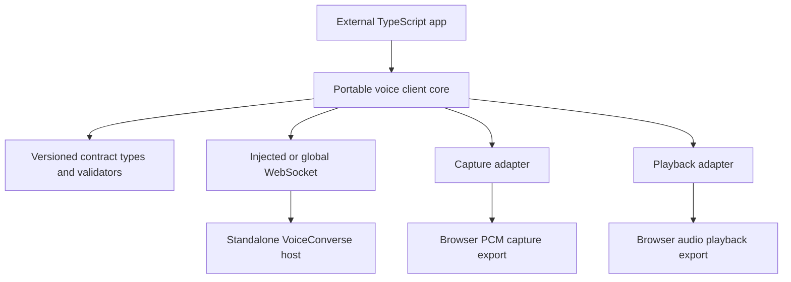
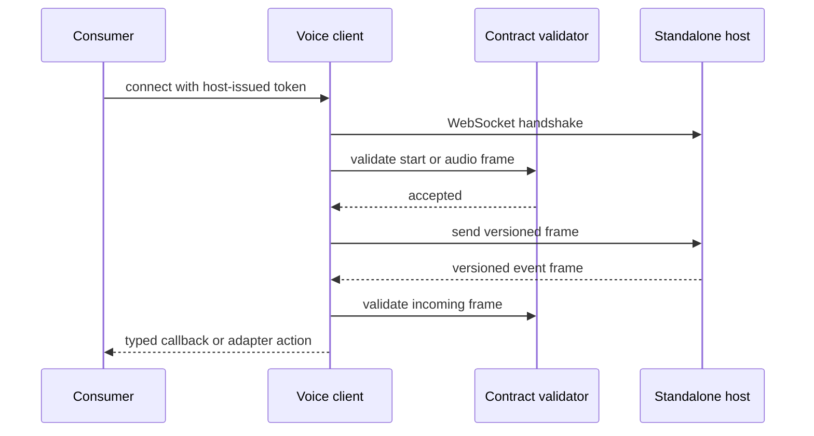
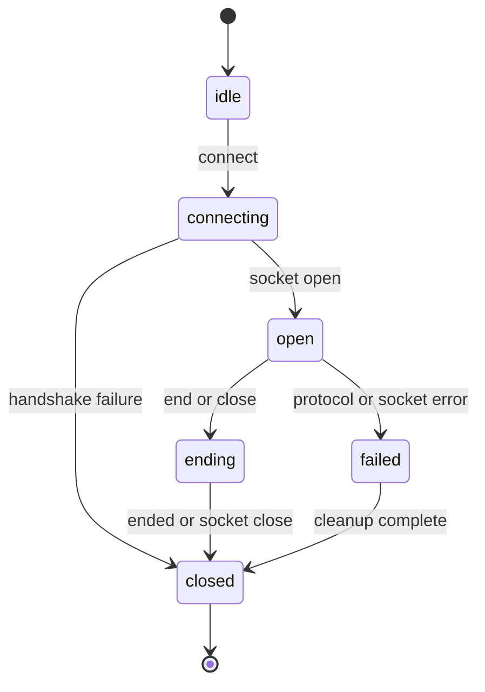
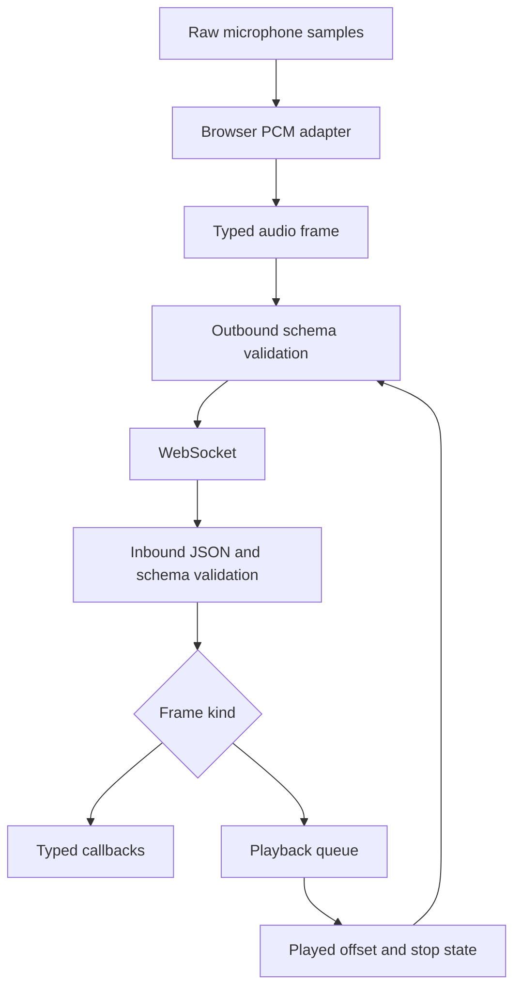

# Voice TypeScript Client - Plan

## Goal Capsule

- **Objective:** Ship a standalone ESM package that embeds a `VoiceConverse` session from browser or Node consumers using the public versioned wire contract.
- **Authority:** Issue #5690 and its 2026-10-23 CODEOWNER acceptance comment take precedence, followed by the contracts in #4091, #4105, #5687, the host in #4092, and repository packaging rules from #5936.
- **Execution profile:** Implement independent client code first, then consume validated blocker branches after their explicit readiness events.
- **Stop conditions:** Stop and reconcile if an upstream frame, token, or release contract contradicts this plan; do not duplicate blocker-owned schemas, host code, timing frames, usage frames, or release machinery.
- **Tail ownership:** This ticket owns package tests, consumer documentation, mutation evidence, a ready PR, and every required CI repair caused by its diff.

---

## Product Contract

### Summary

An external TypeScript application can connect to a host-issued voice session without importing Aiur application code.
The package validates every frame against the public schemas, drives replaceable capture and playback adapters, and presents the full session stream through typed callbacks.

### Problem Frame

`VoiceConverse` exposes a versioned WebSocket protocol, but non-Elixir consumers have no reusable client that enforces that contract.
Hand-written consumers would otherwise duplicate authentication, frame validation, lifecycle, audio routing, and forward-compatibility behavior.

### Requirements

**Packaging and portability**

- R1. Publish a standalone `@aiur/voice-client` ESM package with no Aiur imports and no runtime dependency except the matching public voice contract package.
- R2. Keep the core importable in browsers and Node without a Node-only or DOM-only top-level import.
- R3. Expose replaceable WebSocket, microphone capture, and audio playback adapters, with browser audio implementations isolated behind a browser-specific export.
- R4. Tie the package version to the wire contract version and include it in the repository's npm dry-run and publish flow.

**Protocol and credentials**

- R5. Accept a token issued by the host only for connection setup, never mint, persist, log, or refresh credentials, and support the browser-compatible host token transport.
- R6. Send start, audio, text, draft confirmation, draft discard, playback state, and end frames through the versioned public contract.
- R7. Validate every outbound frame before sending and every inbound frame before dispatching it; invalid frames become protocol errors rather than typed events.
- R8. Preserve v1 additive-field compatibility while rejecting an unknown version or a frame that violates its selected version schema.

**Consumer behavior**

- R9. Stream captured microphone chunks into client audio frames and route agent audio frames into the selected playback adapter.
- R10. Surface state, transcript, agent text, timing, usage, interruption, draft, delivery, context-gap, error, and ended events through typed callbacks derived from the contract package.
- R11. Stop queued or active playback on interruption and report playback state using the contract's turn and played-offset fields.

**Verification**

- R12. Run unit tests against schema-valid golden frames, including a test that fails if any client-produced frame is rejected by the contract schema.
- R13. Run the built package in Node against the standalone host from #4092.
- R14. Run the built package in a real browser harness against the same standalone host.
- R15. Prove a packed tarball can be installed and imported by a clean external TypeScript consumer.

### Scope Boundaries

**Owned here**

- The public TypeScript client API, connection lifecycle, adapter contracts, browser audio adapters, schema-backed validation integration, package tests, and consumer-facing documentation.
- Node and browser end-to-end clients that exercise the standalone host as an outside consumer would.

**Owned by declared blockers**

- #4091 owns frame schemas, golden fixtures, generated contract types, the Elixir codec, and standalone WebSocket transport.
- #4105 owns assistant timing and playback-state wire fields.
- #5687 owns usage frames and session attribution.
- #4092 owns the standalone example host used by both end-to-end runs.
- #5936 owns the shared release/version mechanism and external-consumer distribution proof.

**Outside this change**

- Provider credentials, token issuance, token refresh, automatic reconnection, session hosting, persistence, account attribution, UI composition, and Node audio-device implementations.

### Acceptance Examples

- AE1. Given a host token and a valid socket, when the consumer connects and starts capture, then each captured chunk becomes a schema-valid audio frame and agent audio reaches playback in order.
- AE2. Given transcript, timing, and usage frames with additive fields, when the client receives them, then typed callbacks receive the known v1 data and the connection remains open.
- AE3. Given an outbound frame missing a required field, when the caller attempts to send it, then nothing reaches the socket and the client reports a protocol error.
- AE4. Given malformed JSON, an unknown version, or a schema-invalid server frame, when it arrives, then no typed event callback runs and the client closes with a protocol error.
- AE5. Given an interruption during playback, when the client stops its adapter, then it sends the measured playback state for the interrupted turn.
- AE6. Given the packed package installed in clean Node and browser consumers, when both connect to the standalone host, then they complete a scripted session without resolving files from the Aiur checkout.

---

## Planning Contract

### Key Technical Decisions

- KTD1. Package the client as `@aiur/voice-client` beside `packages/aiur-contracts`, with core, browser, and testing export paths.
- KTD2. Treat the contract package as the sole frame authority: import its generated types and compile its JSON Schemas into self-contained validators during development so consumers do not install a validator runtime.
- KTD3. Keep the core transport structural and platform-neutral: it depends on small socket, capture, playback, and clock interfaces rather than browser or Node classes.
- KTD4. Use the platform's global standards-compatible WebSocket by default when available, while allowing callers and tests to supply a factory.
- KTD5. Hand the host-issued token to the selected connection adapter exactly once: the browser adapter uses the query transport defined by #4091, while a Node adapter may use the authorization header; the client discards the option after socket construction and excludes credentials from errors and debug output.
- KTD6. Reject an invalid outbound frame synchronously before socket send; treat invalid inbound data as a terminal protocol error before any typed callback is invoked.
- KTD7. Route known server-frame variants through exhaustive typed dispatch, while schema-permitted additive fields remain ignored by v1 behavior.
- KTD8. Keep Node and browser end-to-end tests as clean consumers of a packed tarball so monorepo-only imports and unpublished files cannot make them pass.

### Assumptions

- The v1 schemas from #4091 expose distinct client-to-server and server-to-client unions and keep `additionalProperties` compatible where v1 additive evolution is intended.
- The standalone host from #4092 accepts its issued browser token through the query parameter defined by #4091 and can run with its fake provider in CI.
- The Node end-to-end lane runs a release with the standards-compatible global WebSocket; earlier Node releases can use the documented socket factory adapter.
- Browser capture emits the PCM format selected by the wire schema; resampling and encoding belong to the browser adapter, not the core lifecycle.
- #5936 provides the final shared version source and publish workflow hook; this ticket adds its package-specific metadata and verification without inventing a second release mechanism.

### High-Level Technical Design

These sketches are directional boundaries, not implementation specifications.

### Risks and Dependencies

- Upstream frame names or schema export paths may differ from the issue prose; integration must follow validated blocker output rather than preserving speculative local names.
- Browser audio resampling can introduce timing drift; adapter tests use deterministic sample clocks and the browser harness verifies interruption reporting.
- Tokens in browser WebSocket URLs can leak through careless logging; the client never includes the constructed URL in errors or callback payloads.
- Schema validator generation can drift from fixtures; generation and check scripts must fail on uncommitted output or schema-invalid golden frames.
- A path-linked end-to-end test would give false confidence; both clean-consumer runs install the packed tarball and the externally consumable contract dependency.

---

## Implementation Units

### U1. Package foundation and portable lifecycle

- **Goal:** Create the publishable ESM package and a platform-neutral connection lifecycle with injectable transport and audio boundaries.
- **Requirements:** R1-R5, R9.
- **Files:** `packages/voice-client/package.json`, `packages/voice-client/tsconfig.json`, `packages/voice-client/src/client.ts`, `packages/voice-client/src/adapters.ts`, `packages/voice-client/src/index.ts`, `components/voice-client.json`.
- **Approach:** Follow the strict TypeScript and package-export patterns in `packages/streamdeck`, but keep all environment capabilities behind structural interfaces and contract-only dependencies.
- **Test scenarios:** Open, close, and connection-failure transitions; sends queued before open; capture start/stop cleanup; repeated close; unavailable default WebSocket; token redaction from errors.
- **Verification:** Package typecheck, lint, unit tests, build, and export-map import smoke tests.

### U2. Contract validation and typed event dispatch

- **Goal:** Consume #4091, #4105, and #5687 types/schemas so all outbound and inbound frames are validated and exhaustively dispatched.
- **Requirements:** R6-R8, R10-R12; KTD2, KTD6, KTD7.
- **Files:** `packages/voice-client/scripts/generate-validators.mjs`, `packages/voice-client/src/generated/validators.ts`, `packages/voice-client/src/frames.ts`, `packages/voice-client/test/frames.test.ts`.
- **Dependencies:** Explicit readiness and validated refs from #4091, #4105, and #5687.
- **Approach:** Generate deterministic self-contained validators from the contract package's v1 schemas, then use generated contract unions for outbound builders and inbound routing.
- **Test scenarios:** Every golden client frame sends; every golden server frame reaches the matching callback; additive fields remain accepted; missing or renamed required fields fail; malformed JSON and unknown versions are terminal; a rejected outbound frame produces zero socket writes.
- **Execution note:** Run the frame-production mutation with the production builder hunk removed or altered before recording coverage.
- **Verification:** Generated output drift check, contract golden-fixture validation, unit tests, and package typecheck.

### U3. Browser audio adapters

- **Goal:** Provide browser-specific microphone capture and queued playback without introducing DOM dependencies into the core export.
- **Requirements:** R2, R3, R9, R11.
- **Files:** `packages/voice-client/src/browser/capture.ts`, `packages/voice-client/src/browser/playback.ts`, `packages/voice-client/src/browser.ts`, `packages/voice-client/e2e/browser-adapters.spec.ts`.
- **Dependencies:** Completed U2, including the playback-state fields from #4105.
- **Approach:** Keep Web Audio and media-device access inside the browser export, start capture only after the caller's user gesture, and expose deterministic clocks for tests.
- **Test scenarios:** PCM chunk ordering; resampling boundary values; denied microphone access; playback sequencing; interruption clears queued audio; played offset is monotonic; all browser resources close after session end.
- **Verification:** Browser-adapter unit tests in the Playwright harness and core import in a Node process with no DOM globals.

### U4. Clean-consumer Node and browser end-to-end runs

- **Goal:** Prove the built client completes a scripted voice session against #4092 from both supported runtimes.
- **Requirements:** R13-R15; KTD8.
- **Files:** `packages/voice-client/e2e/consumer/package.json`, `packages/voice-client/e2e/node.test.mjs`, `packages/voice-client/e2e/browser.spec.ts`, `packages/voice-client/playwright.config.ts`, `.github/workflows/voice-client.yml`.
- **Dependencies:** Explicit readiness and a validated ref from #4092, plus completed U1-U3.
- **Approach:** Pack the client and contract packages, install their tarballs into a temporary consumer, start the standalone host with its fake provider, and run the same scripted session in Node and Chromium.
- **Test scenarios:** Host-issued token connection; mic/audio exchange; transcript, timing, and usage callbacks; interruption and playback report; clean end; bad token refusal; no path import from the monorepo.
- **Execution note:** The test process must name each collected Node and browser test in output so the runner configuration is reviewable.
- **Verification:** Focused Node test, focused Playwright spec through the browser build gate, and tarball-content inspection.

### U5. Distribution and consumer documentation

- **Goal:** Integrate with #5936 so the client and contract versions publish together and external hosts have copyable dependency and import guidance.
- **Requirements:** R1, R4, R15.
- **Files:** `packages/voice-client/README.md`, `website/docs-app/guide/voice-converse.md`, `website/docs-app/.vitepress/config.ts`, package-specific release files selected by #5936.
- **Dependencies:** Explicit readiness and a validated ref from #5936, plus U1-U4.
- **Approach:** Extend the shared version and npm release flow, document core and browser entry points, and keep token/provider ownership on the host side.
- **Test scenarios:** Dry-run package contents include built exports and declarations; package and contract versions match; a clean consumer installs both tarballs; documented imports resolve; private source and test files are excluded.
- **Verification:** Shared release checks, npm pack dry run, clean-consumer smoke, website guards, and link validation.

---

## Verification Contract

| Gate | Applies to | Done signal |
|---|---|---|
| Package check | U1-U3 | The package lint, typecheck, generation check, build, and unit tests pass from `packages/voice-client`. |
| Contract parity | U2 | Every client golden frame validates before send and every server golden frame validates before typed dispatch. |
| Node end to end | U4 | A clean Node consumer installs tarballs and completes the scripted standalone-host session. |
| Browser end to end | U3-U4 | The focused Playwright spec completes the same session and observes audio, transcript, timing, and usage behavior. |
| Packaging | U4-U5 | Dry-run tarball contents and clean installs prove no monorepo-only path is required. |
| Mutation coverage | U2-U4 | Each new behavior test fails when its guarded production hunk is removed in an isolated worktree, then passes restored. |
| Repository quality | All | `mix compile --warnings-as-errors`, formatting, affected tests, `mix lint`, bare-receive guard, structural gate, PR-body check, pre-handoff guards, and `aiur pre-pr` pass where applicable. |

Manual-only acceptance remains outside the issue workspace.
If a real-key or hands-on browser audio check is still required at handoff, the PR body records the exact action under `## Local tests` as `Post-deploy check:` and names the operator; it does not claim the check ran here.

---

## Definition of Done

- All R1-R15 requirements and AE1-AE6 examples are implemented without temporary schemas, host doubles standing in for the required end-to-end test, or unpublished stubs.
- The package is importable in Node and browser consumers, and the core has no Node-only, DOM-only, or Aiur runtime import.
- Frame callbacks, builders, and validation derive from the released contract version, including timing and usage frames.
- Node and browser end-to-end tests run against the standalone host through packed packages.
- The shared release flow dry-runs the client and ties its version to the contract version.
- Package and website documentation describe token ownership, adapters, imports, and supported runtimes without exposing credentials.
- Every new test has revert-based mutation evidence or an explicit, justified exception in the PR body.
- Abandoned experiments, temporary stubs, generated drift, debug logging, and workspace-only paths are absent from the final diff.
- The PR is self-reviewed against its claims, marked ready, and passes the full required-check set on its current head before human-review handoff.

---

## Appendix

### Sources and patterns

- Issue #5690 and its 2026-10-23 CODEOWNER acceptance comment define the consumer package contract.
- Issues #4091, #4092, #4105, #5687, and #5936 define upstream wire, host, timing, usage, and release boundaries.
- `packages/aiur-contracts/` provides the schema, fixture, type-generation, and additive-v1 patterns.
- `packages/streamdeck/src/channel-types.ts` and `packages/streamdeck/src/channel.ts` demonstrate structural socket injection, but the new package does not import them.
- `.github/workflows/aiur-contracts.yml` and `.github/workflows/release-npm.yml` provide package validation and release conventions.
