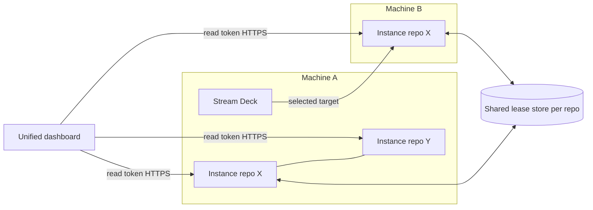

# Multi-Repo Multi-Machine Aiur - Plan

## Goal Capsule

- **Objective:** One operator runs Aiur on any mix of repositories and machines. They see all of it in one dashboard, and no ticket runs twice. The single-repo, single-machine setup stays the uncomplicated default.
- **Product authority:** Kevin's scope note of 2026-10-27, items 6 (multi-repo/multi-machine and unified dashboard) and 7 (Stream Deck in the multi-instance design). Mobile stays paused and is not a prerequisite.
- **Open blockers:** Kevin's answers to the questions at the end of this plan. Kevin's Claude Design artifact for the unified dashboard UI. Neither blocks phases 0 and 1.

---

## Product Contract

### Summary

Finish the coordination layer that already exists rather than build a new one. The shared lease store, ownership rules, leader election, roster, instance summary and remote control are already merged. Close the remaining duplicate-dispatch gaps, make one repository safe on several machines, and add a desktop unified dashboard. That dashboard reads bounded instance summaries over the existing token-authenticated HTTPS control route. Executors agree on rare plan changes in Khala chat and apply them as machine-readable config, so routine sync costs no tokens.

### Problem Frame

Today two Executors, one per machine, share one repository. What keeps them apart is a habit: each daemon has its own label prefix, and hand-offs are relabels announced in chat. Nothing enforces it. Tickets carry both prefixes' done labels, and a hand-off once collided with an open PR. Each machine has its own dashboard URL. Kevin asks separate sessions for separate links and combines the views himself. Chat sync runs at about 30 messages a day per side, and most of it is status that GitHub already holds. The coordination code that would fix most of this has merged, but it switches on only when both daemons share a lease database, and no deployment proof exists yet (#5974 is parked). Kevin said: "I don't want this synchronization to be purely living in a Kala chat."

### Usage configurations

| Configuration | What the user gets | Coordination needed | Status today |
|---|---|---|---|
| 1 repo × 1 machine | Today's experience, unchanged. No lease store, no registry, no extra UI. | None | Works |
| 1 repo × N machines | One view of the repository. Each ticket runs on exactly one machine. Machine shown where it matters. | Shared lease store, one repository leader, ownership rules | Partly: code merged; gaps below; no live proof |
| N repos × 1 machine | One dashboard that lists each repository's instance, with a repository switcher | Discovery of local instances only; no lease store | Partly: instances are separate; launcher records exist; no dashboard aggregation |
| N repos × N machines | One dashboard across all instances. A repository shared by two machines is counted once. | Both of the above, keyed by repository and by instance | Not started beyond the roster and summary skeleton |

### Reusable inventory

| Piece | State | Reuse for |
|---|---|---|
| Shared ticket lease, heartbeats, `list_live` (#5947) | Merged; enabled only by a shared lease database | Duplicate-dispatch prevention, presence |
| Ownership rules `instance.owns` / `instance.pool` (#5971), live via `aiur set` | Merged | Machine-readable lane map |
| `instance.ignore` filters (#5803) | Merged; hides tickets from observers, not dispatch | Noise suppression |
| Repository leader lease and leader write fence, `instance.role` | Merged | One landing watcher, merge-queue watchdog, quarantine and main watch per repo |
| Shared GitHub budget split by live instance count (#6147, #6276) | Merged | Shared token quota |
| Instance roster and `/instances` page (#5950) | Merged | Machine indicators, liveness |
| Instance summary v1 skeleton (#6859): unknown never shown as zero, redacted, size-capped | Merged skeleton; fields #6730–#6733 in progress | Unified dashboard data unit |
| Remote control route, scoped read/write tokens, audit (MIC-001/002) | Merged | Cross-machine reads and controls |
| Named remote registry, `aiur --instance <name>` and `--instance all` (MIC-003/004, #5994) | Merged; CLI only | Discovery list for dashboard and Stream Deck |
| Merged Executor wake streams (MIC-005/006) | Merged; end-to-end proof parked (#5974) | One Executor across instances |
| Loopback-only Erlang distribution check (MIC-009) | Merged | Security floor: cross-machine traffic is HTTPS only |
| Hosted mode fails closed, env-only secrets, bearer-only API on public bind (#5699, #5700, #5939, #5941, #5945) | Merged | Cloud instance safety |
| Machine store, identity key, settings schema (MP-N2 #6806, #6857, #6858) | Merged; gateway and adverts (~40 tickets) open | Optional later; not needed for desktop dashboard |
| Stream Deck redesign pack, 25 tickets (#6024–#6049), incl. SD-207 instance switcher (#6036) | All open and parked; SD-207's blockers closed | Stream Deck cross-machine targeting |

### Single-machine assumptions that fail

Verified against main at the plan's base commit unless marked.

1. **No lease store means no enforcement.** Without a shared lease database, claims are disabled, and two primaries both act as repository leader. Separation then depends on label prefixes alone.
2. **PR-anchored dispatch skips the lease.** Rework on a ticket with an existing PR head bypasses the shared claim in both dispatch and the agent runner. Ownership rules still apply, but pool tickets can be worked on both machines. This is the most likely duplicate path with the store on.
3. **Lease is per run, not per ticket lifetime.** After one machine finishes, the other can pick the ticket up again if its own prefix still says `todo`.
4. **The build queue is local and leaderless.** Each daemon keeps its own queue document and ordering. The planner can withdraw `todo` from a ticket the peer has leased but not yet relabelled (from code reading; not reproduced).
5. **Lifecycle label writers assume sole ownership.** The merged-ticket reconciler, blocker propagation, review and rework transitions and auto-resume do not consult ownership. Both daemons can write the same transition (from code reading).
6. **Caps and global pause are per daemon.** Max agents adds up across machines. A global pause stops one machine only.
7. **Durable memory is per daemon.** The decision store, landing journals and queue intents live in local state. A leader move starts cold, and a decision can be escalated twice.
8. **Dashboard URL is not stable.** The dashboard port defaults to OS-assigned. A remote reader or Stream Deck pinned to a URL breaks on restart unless the port is pinned or proxied.
9. **The dashboard cannot read another instance.** Remote registry and tokens belong to the CLI. The roster shows heartbeats plus a link, not live data.
10. **Voice needs a browser session on the target.** The voice socket requires a signed dashboard session cookie. No device- or token-authenticated voice path exists (#5729 open).

### Key Decisions

- **Finish, do not rewrite.** The control plane from the multi-instance control pack (MIC-001..009) is merged. This plan closes its gaps and adds aggregation. No new transport or topology is introduced.
- **The shared lease store is the source of truth for "who runs what".** Label prefixes stay as a compatibility layer while the lease store becomes mandatory for 1×N and N×N. 1×1 and N×1 never need it.
- **Repository facts are counted once, instance facts are summed.** Queue, Build Order, PRs, CI and issues are repository facts, read once per repository from its leader. Agents, slots and held tickets are instance facts, deduplicated by instance identity. Shared quotas are shown, never summed.
- **Desktop dashboard first, without the MP-N2 gateway.** The unified dashboard reads instance summaries over the existing read-token control route. The gateway, pairing and mobile remain later options.
- **Private by default.** Cross-machine traffic uses HTTPS on a private network or an authenticated public bind. A private instance is never exposed publicly as a shortcut. Erlang distribution stays loopback-only.
- **Chat for judgment, config for rules.** Executors discuss rare plan changes in Khala and apply the result as ownership rules or config. Routine sync never needs a message.

### Coordination division

| Decision | Mechanism | Owner | Failure and recovery |
|---|---|---|---|
| Which machine runs a ticket now | Automated: shared lease claim | Daemon | Store down: dispatch holds, workers stop at renewal deadline, alert fires; resumes when store returns |
| Rework on an existing PR | Automated: same lease claim (gap 2 closed) | Daemon | As above |
| Repository-wide services | Automated: leader lease and write fence | Daemon | Leader dies: peer takes over after TTL; journals start cold until shared |
| Lane map (labels, components, tickets per machine) | Hybrid: agreed in chat once, applied with `aiur set instance.owns` | Executors, recorded in config | Owning machine absent: its tickets return to the pool after heartbeat expiry |
| Hand-off of one ticket | Automated command: refuses when an open PR exists, moves ownership, comments on the ticket | Executor runs it; no chat | Refusal names the blocking PR |
| Presence, capacity, provider-limit state | Automated: heartbeat metadata, shown in roster | Daemon | Stale heartbeat shown as stale, never as zero |
| Queue starvation on one machine | Automated alert, then hybrid re-plan | Daemon raises; Executors decide | One alert per starvation episode |
| Hub-file review requests | Automated: auto-label and wake the owner | Daemon | Owner absent over a set window: peer may review (rule agreed once) |
| Cross-lane design conflicts, lane changes, rule exceptions | Executor chat | Executors; Kevin on escalation | Recorded as a decision, then applied as config |
| Status reports | None: read from GitHub and the dashboard | — | — |

**Token estimate.** Chat sync now costs about 25M cached-read tokens a day per Executor, about 50M for both. That is 2–3% of one Executor's volume, plus focus lost to message-triggered rechecks (order of magnitude, from the PC session only). With the automations above, chat should fall to 3–5 messages a day, waking only on mentions.

### Requirements

**Duplicate-free execution**

- R1. With a shared lease store configured, no ticket has two live workers across machines, including rework on an existing PR.
- R2. A finished ticket is not run again by a peer because of a stale lane label.
- R3. Exactly one instance per repository runs repository-wide services. A second primary without a shared store is refused or warned at boot.
- R4. Lifecycle label transitions for a ticket are written only by the instance that owns or last held it.
- R5. The build queue order for a repository has one authority, and a peer never withdraws `todo` from a ticket another instance holds.

**Configuration and simplicity**

- R6. 1×1 needs no new config, service, token or UI element. Its dashboard looks as it does today.
- R7. Joining a second machine to a repository is a documented, checkable setup: shared store, role, ownership. `aiur doctor` reports what is missing.
- R8. Ownership rules and hand-offs are machine-readable, live-reloadable, and visible to both Executors without chat.

**Unified dashboard**

- R9. One dashboard lists every registered instance, with its repository, machine, liveness and agent count.
- R10. A repository served by several instances is shown once. Repository facts are not double-counted, and instance facts carry a machine indicator.
- R11. Unknown or unreachable data is shown as unknown or unreachable, never as zero or silently dropped.
- R12. Existing home and Build Order views gain machine indicators where work runs on more than one machine, and show nothing new in 1×1.
- R13. The dashboard reads remote instances with read-scoped tokens only. Write actions go to the owning instance with its own authorization.
- R14. Final navigation and layout follow Kevin's Claude Design artifact. Until then, only the data contract and a plain listing ship.

**Stream Deck**

- R15. The existing Stream Deck scope (#6024 pack) is inventoried as merged, live, verified, in flight or blocked before new Stream Deck work starts.
- R16. A Stream Deck on one machine can select any registered instance and agent as its target without editing files or restarting the sidecar.
- R17. Control and voice from the deck reach the selected target's instance, with that agent's context, and confirm the destination on the deck.
- R18. When the target becomes unreachable, the deck shows it and does not send to a different target.
- R19. Non-voice Stream Deck work does not wait for the voice-provider choice. Final voice wiring waits for it.

**Networking, hosting and remote voice**

- R20. Instances find each other through an explicit registry or the lease-store roster, not network scanning.
- R21. A cloud instance can join under the same rules as a local one, with secrets from the environment only and no public exposure of home instances.
- R22. Remote voice and control have a token- or device-authenticated path that does not need a browser session on the target's origin.

### Acceptance Examples

- AE1. **Covers R1.** Given two machines on one repository sharing a lease store, when a reviewer requests changes on a PR, then only one machine starts the rework worker.
- AE2. **Covers R3.** Given two daemons configured as primary without a shared store, when the second boots, then it refuses repository-wide services and says why.
- AE3. **Covers R10.** Given repository X on machines A and B with 12 open queue tickets, when the dashboard shows X, then it shows 12, not 24, and agents as "A: 5, B: 3".
- AE4. **Covers R11.** Given machine B is offline, when the dashboard loads, then B's row reads "unreachable since <time>" and totals mark B's share as unknown.
- AE5. **Covers R6.** Given one repository on one machine with no registry or store, when the operator opens the dashboard, then nothing new appears.
- AE6. **Covers R16, R18.** Given the deck on machine A targets an agent on machine B, when B goes offline, then the deck shows B unreachable and refuses to send.

### Cloud and Railway assumptions (candidate only)

- Railway is a candidate host, not approved. No purchase or deploy follows from this plan.
- A hosted instance is a public bind. It requires an HTTPS public URL, browser sign-in, bearer-only API, env-only secrets, and the cgroup-aware load gate. All of these are merged.
- Still missing: a service image and template (#5940), a deploy guide (#5954), webhooks at the service's own URL (#5951), and daemon-side push before current backends are hosted-eligible (#5701).
- The cloud instance can reach home instances only if it joins the private network, or if home instances are never reached from it. Kevin decides which (Q2).
- The lease store must be reachable by every machine on a repository. A managed Postgres beside the cloud host is the default candidate.

### Phased plan

| Phase | Outcome | Depends on |
|---|---|---|
| 0. Prove what is merged | Lease store deployed for the shared repository. MIC-010 (#5974) evidence collected. Stream Deck inventory (R15) published. | Kevin Q1 (store host) |
| 1. Close duplicate gaps | R1–R5 and R7: lease on rework, per-ticket completion guard, two-primary refusal, owner-only label writers, single queue authority | Phase 0 |
| 2. Automate coordination | R8 and the coordination table: hand-off command, presence and capacity in heartbeats, starvation alert, hub-review routing. Khala becomes mentions only. | Phase 1 |
| 3. Dashboard data | R9–R13: summary fields finished, dashboard-side registry and read-token fan-out, repository/instance dedup, plain listing | Phase 1; parallel with 2 |
| 4. Stream Deck targeting | R16–R18, R19: promote SD-207 instance switcher and the non-voice SD tickets; stable dashboard URL | Phase 3 data; not voice |
| 5. Unified UI | R12, R14: Kevin's design applied | Claude Design artifact |
| 6. Remote voice and cloud | R21–R22, R17 voice: device-authenticated voice path, relay choice, hosted instance joins | Provider choice; Kevin Q2–Q4; Railway approval |

### Scope Boundaries

- Multi-user tenancy and organization management are out of scope.
- Mobile, watch and the MP-N2 gateway and pairing are not prerequisites. They stay deferred with mobile.
- No new transport, mesh or service discovery protocol.
- No public exposure of private instances, including tunnel shortcuts.
- Final dashboard layout waits for the design artifact.

### Questions for Kevin

- Q1. Where should the shared lease database live: on one home machine reachable over the private network, or as a managed database next to the future cloud host? Recommendation: managed, so no home machine is a single point of failure.
- Q2. May a cloud instance join the private network to read home instances, or must home instances never be reachable from the cloud? Recommendation: join, read-scoped tokens only.
- Q3. Where should the unified dashboard run: on every instance (any can show all), or on one designated home instance? Recommendation: every instance, with a registry it shares.
- Q4. For Stream Deck voice to a remote agent, should audio go through the local daemon (it holds the voice provider and relays text and control), or straight to the remote instance? Recommendation: through the local daemon, so credentials stay in one place.
- Q5. Once the lease store is live and the automations land, should there still be one Executor per machine, or one Executor across all instances? Recommendation: one Executor, with the second machine running daemon-only.
- Q6. Should the public Funnel option be removed or hard-gated for private instances? Recommendation: hard-gate (from code reading; not live-tested).
