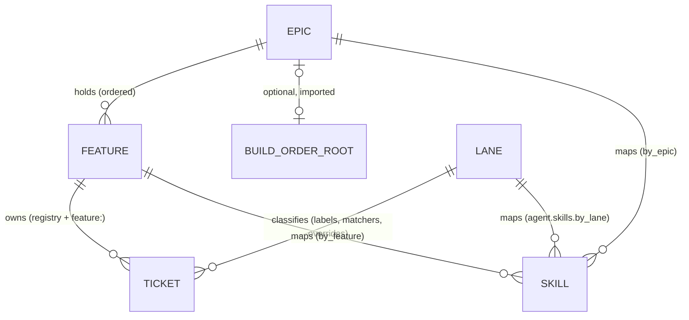
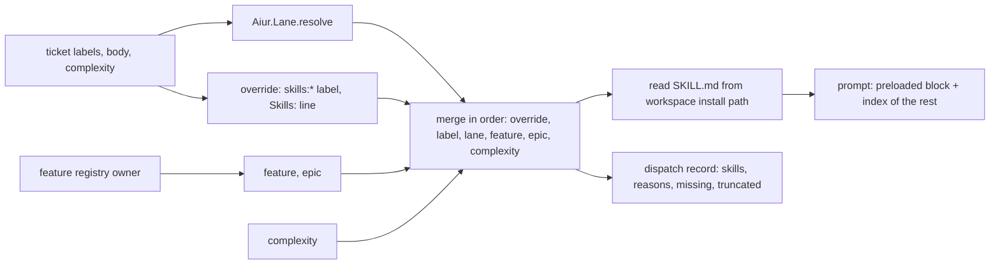
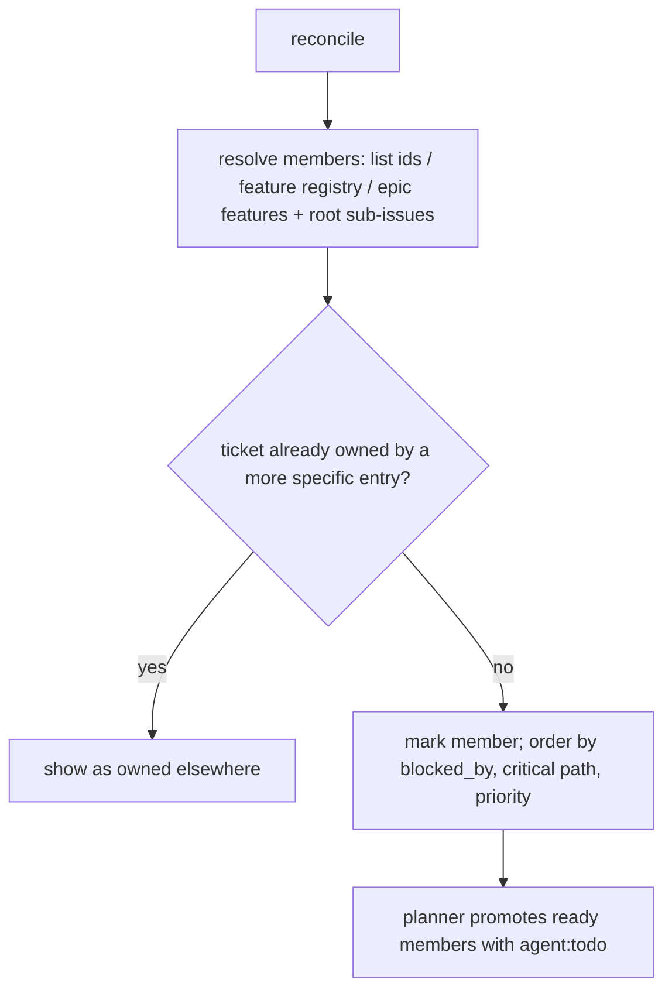
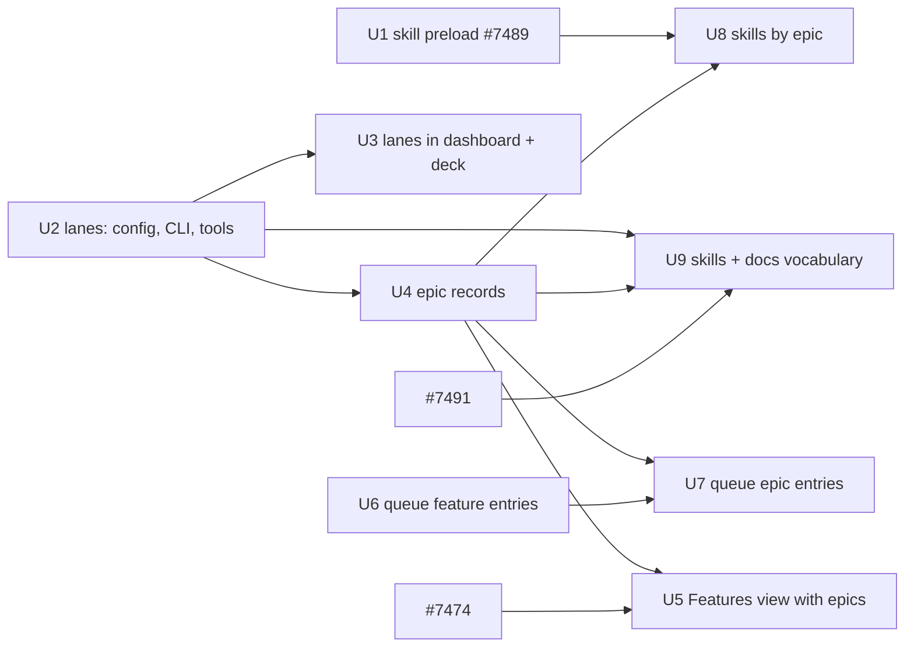

# Epic, Feature and Lane - Plan

## Goal Capsule

- **Objective:** Move aiur to the industry hierarchy **Epic > Feature > ticket**, with **Lane** as the technical column. Show epics in the Features view. Let the build queue take epics and features as live entries. Give workers preloaded skills by lane.
- **First deliverable:** lane-based skill preload (#7489). It ships before any rename, because the game maker's next run waits on it.
- **Product authority:** the operator's decisions of 2026-11-04 (vocabulary, Features view, queue, skills by lane) are binding. Where this plan picks a default the operator did not state, it is listed under Open Questions with the default.
- **Stop conditions:** stop and report if a unit would need a GitHub relabel of more than 50 issues, a breaking change to a shipped CLI verb without an alias, or a journal rewrite in place.
- **Tail ownership:** each unit is one GitHub ticket (see Ticket Breakdown). Workers own their PR to merge. The Executor owns rebuild, restart and the live check after each merge.

---

## Product Contract

### Summary

Aiur uses the words feature, epic and lane today, but not as the industry does. A "feature" holds "epics", and those "epics" are really technical columns. This plan keeps **Feature** as is, turns today's column-like "epics" into **Lanes**, and adds a real **Epic** level above features. A Build Order root becomes an epic. The queue learns to hold epics and features as units. Workers get skills that match their lane.

### Problem Frame

- The operator plans work as epics that hold features, and features that hold tickets, spread over lanes. Aiur's registry nests the other way round (`aiur feature create … --epic` puts epics inside a feature) and the dashboard calls its lane columns "epics".
- "Epic" has four meanings in the code today: the number of lanes in a root (`epic_count`), configured general epics (label buckets), feature epics (columns inside a feature), and the `aiur epic set` override journal. Any new feature built on these words inherits the confusion.
- The Executor has to queue tickets one by one. A ticket filed later under a feature does not join the queue by itself.
- Every worker gets the same skill set. A pixel-art ticket starts with the same context as a CI ticket. The game maker's implementation agents wait on this.

### Vocabulary (binding)

| Term | Meaning | Today's equivalent |
|---|---|---|
| Epic | A large initiative over many tickets, maybe several features. | A Build Order root plus its sub-issues; a root imported as feature `bo-<n>`. |
| Feature | A smaller collection of tickets inside an epic. | A registry feature (`feature:<slug>` label). Unchanged. |
| Lane | A technical column: frontend, backend, docs, art, audio. | `build-lane:*` labels, `area:*` labels, `build_order.general_epics`, feature "epics", dashboard columns, `aiur epic set` overrides. |

### Requirements

**Skills by lane (first)**

- R1. A worker's cold prompt lists the skills mapped to its ticket first, with each skill's `SKILL.md` text included in full, and lists every other installed skill only as a one-line name and description.
- R2. Skills map from lane, feature, label and complexity in config, and later from epic. Sets are combined. The config hot-reloads.
- R3. One ticket can add skills with a `skills:<name>` label or a body line `Skills: a, b`, and replace the mapped set with `Skills only: a, b`.
- R4. The dispatch record and `aiur agents` show which skills a worker got and the reason for each (for example `pixel-art (lane:art)`).
- R5. An unknown skill name produces a visible warning in the dispatch record and the log. It is never dropped silently.
- R6. A ticket's lanes come from its `lane:*`, `area:*` and `build-lane:*` labels and from the label matchers of configured lanes. No GitHub relabel is needed.

**Vocabulary and migration**

- R7. Every user-facing surface says Lane where it means a technical column: config, CLI, agent tools, dashboard, Stream Deck, docs and skills.
- R8. Old names keep working for at least one minor release: `build_order.general_epics`, `aiur epic set|clear|confirm`, `aiur_set_epic`, `feature … --epic`, the `epic=` and `list=epics` URL parameters, and the Stream Deck `default_view: epic` setting. Each old name prints or logs a deprecation notice that names the new one.
- R9. An existing install upgrades with no manual step and no data loss. The feature registry journal is not rewritten. A rollback to the previous build still boots.
- R10. An Epic is a first-class record: slug, label, icon, colour, optional Build Order root, ordered features. Build Order roots become epics automatically.

**Features view**

- R11. The Features view groups features under their epic. Each epic row shows its own merged/total bar; its features follow it, indented. Features with no epic appear under "No epic".

**Build queue**

- R12. A queue entry is one of: an exact list of ticket ids, a feature, or an epic. Lists keep their order. Inside a feature or epic, dependency order (`blocked_by`, then critical path, then priority) applies.
- R13. A ticket added later to a queued feature or epic joins that entry on the next reconcile, with no Executor action.
- R14. Holds, set ranks, `blocked_by` gating and start triggers work for feature and epic entries exactly as for lists and Build Order roots today.

### Acceptance Examples

- AE1. Config maps lane `art` to `pixel-art` and `palette`. A ticket labelled `area:art` dispatches. Its prompt starts the skills block with both skills in full; `aiur agents` shows `skills: pixel-art (lane:art), palette (lane:art)`.
- AE2. The same ticket's body says `Skills: shader-tips`, and no skill of that name is installed. The worker still gets the two lane skills. The dispatch record carries `missing: shader-tips`, and the log has a warning.
- AE3. A ticket labelled both `build-lane:docs` and `area:ui` gets the union of the `docs` and `ui` lane skills.
- AE4. `aiur queue add --feature combat` while `combat` has 6 open tickets. Later the Executor runs `aiur feature add combat 912`. On the next reconcile, `aiur queue show` lists 912 in the `combat` entry.
- AE5. Ticket 900 is in an explicit list entry and also in feature `combat`, which is queued. The list entry owns 900; the `combat` entry shows it as owned elsewhere and does not refuse the feature.
- AE6. An operator still runs `aiur epic set ui 812`. The override applies to lane `ui`, and stderr says `aiur epic set is deprecated; use aiur lane set`.
- AE7. After the upgrade, the operator rolls back to the previous build. The registry boots and every feature and member is intact; only epic records (kept in a separate file) are invisible to the old build.

### Scope Boundaries

- **No GitHub relabel.** `area:*` (about 1,100 labelled issues in this repo) and `build-lane:*` labels stay; they are read as lane labels. New tickets may use `lane:<slug>`.
- **No `epic:*` labels.** That prefix already marks a parked ticket (`src/lib/aiur/build_queue/planner_policy.ex:220`). Epic membership lives in the registry and in root sub-issues.
- **"Build Order" stays** as the name of the planning pack, the graph view and the `build-order` root label. In the UI, a root is called an epic.
- **No harness-level skill filtering.** Aiur does not hide installed skills from the agent's own skill list; the prompt steers. The installer never overwrites a skill and the account profile shares global skills, so filtering would need changes in both places.

#### Deferred to Follow-Up Work

- The `build-order.v1` contract and package (#7490) adopt this vocabulary; their implementation stays on #7490.
- Layering `aiur-build` on the shared `build-order` skill (#7491) stays on #7491; the skill vocabulary unit (U9) follows it.
- Epic colour assignment (#7447, PR open) lands as is; U2 carries its stored colours over to lanes.

---

## Planning Contract

### Key Technical Decisions

- KTD1. **Skill preload ships on today's names with its own lane resolver.** A small `Aiur.Lane` module resolves lanes from labels and general-epic matchers. The rename (U2) reuses it. (session-settled: user-directed — chosen over waiting for the rename: the game maker's run is blocked on skills.)
- KTD2. **Skill text comes from the workspace after install.** The prompt builder reads `SKILL.md` and the frontmatter `description` from the provider's install path (`.claude/skills`, `.codex/skills`, `.agents/skills`), so the repo's own skills and aiur's vendored skills both count.
- KTD3. **Preload is bounded.** `agent.skills.preload_max_bytes` (default 32 KiB) caps inlined skill text. Skills past the cap degrade to a "load now" line with name and description, and the record says `truncated`.
- KTD4. **Only cold and continuation prompts carry the skill block.** A resumed session already has it; later turns do not repeat it.
- KTD5. **Lanes keep today's general-epic config shape.** `build_order.lanes` takes the same fields as `build_order.general_epics` (key, label, label matchers, hue, icon) plus nothing new; the old key is an alias. Skill mappings stay under `agent.skills`, so the preload config is independent of display config.
- KTD6. **Epics live in a separate journal file**, `build-features/epics.ndjson`, owned by the same `Aiur.BuildOrder.Features` writer. The v1 `features.ndjson` keeps its format. An older build ignores the new file, so rollback is safe (AE7).
- KTD7. **Legacy feature epics are reinterpreted at read time, not rewritten.** A v1 `feature.epic_added` event defines a lane; a member's `epic` key resolves to that lane. Features imported from roots (`bo-<n>`, source root import) project as epics.
- KTD8. **Queue entries extend the existing kinds.** `Queue.kind` gains `:feature` and `:epic`; `:build_order` becomes an epic entry with a root. Feature and epic entries sync membership on each reconcile, the way `BuildOrderCommands.sync/1` does for roots today.
- KTD9. **The most specific entry owns a ticket.** A list owns over a feature, and a feature over an epic. Today one ticket may belong to one queue only, and a second adopt is refused; for feature and epic entries a lost ticket is shown as owned elsewhere instead of failing the adopt.
- KTD10. **Deprecation through aliases, not version forks.** Old CLI verbs, flags, URL parameters, config keys and the agent tool name map to the new ones in one place each and log a notice. Removal is a separate later ticket after one minor release.

### High-Level Technical Design

**Data model after the change**

**Skill resolution at dispatch**

**Queue entry ownership**

### Migration Strategy

| Surface | Running installs (this repo, game maker on npm 0.0.9) | Mechanism |
|---|---|---|
| Feature registry journal | Unchanged file and format. | Read-time reinterpretation (KTD7). Epics in a new file (KTD6). |
| Epic overrides journal (`epic-overrides/epic-overrides.json`) | Kept as the lane override store. | Path unchanged; only the CLI and docs say lane. |
| Config `build_order.general_epics` | Accepted, deprecation warning at load. | Alias to `build_order.lanes`; both set is an error. |
| Config `build_order.feature_order` | Unchanged. | — |
| GitHub labels | No relabel. | `area:*`, `build-lane:*`, `lane:*` all read as lanes. `feature:*` unchanged. |
| CLI | Old verbs and flags work and warn. | `aiur epic set|clear|confirm` → `aiur lane …`; `feature create --epic key=label` → lane definition; `feature add --epic k` → `--lane k`. `aiur epic show|list` switch to the new Epic meaning at once. |
| Agent tools | `aiur_set_epic` still accepted. | Alias to `aiur_set_lane`. |
| Dashboard URLs | Bookmarks keep working. | `epic=` → `lane=`; `list=epics` → `list=lanes` (rewritten on load). |
| Stream Deck sidecar | Older sidecar settings keep working. | `default_view: epic` read as `lane`. |
| Build payload | Dashboard JS ships in the same release, so it changes with the daemon. | Payload carries `lanes`, `lane_progress`, `epics` (new meaning); the field change is one release step. |
| Queue store (`build-queue/queue.json`, v1) | Existing `:list` and `:build_order` sets load unchanged. | New kinds added to the codec; an older build refuses an unknown kind, so U6 writes a kind only when the operator adds a feature or epic entry. |

**GitHub cost.** The plan writes no labels on existing issues. If the operator later wants a relabel, the existing label writer runs at most `build_queue.max_writes_per_minute` (20/min) and 60/h (`website/docs-app/apis/github-budgets.md:236-246`). About 1,100 `area:*` issues plus 139 `build-lane:*` references would take at least 20 hours at 60/h. This is the reason for "no relabel".

### Sequencing

U1, U2 and U6 have no dependencies and can run in parallel. U1 is priority 1.

### Risks

- **Prompt size.** Inlined skills can crowd the context. Mitigated by KTD3 and by measuring the byte count in the dispatch record.
- **Untrusted override.** The `Skills:` body line is ticket content. It may only name installed skills; it cannot inject text, because the text comes from the workspace files.
- **Verb collision during the window.** `aiur epic show` changes meaning at once. Scripts that parse its output break. The aiur-build publication scripts are the known caller; U9 updates them, and U2 keeps `--json` output for `aiur lane show` identical to the old `aiur epic show --json`.
- **Parallel work on the same files.** #7447 (epic colours) and #7474 (Features view) have open PRs in `features.js`, `list.js` and the registry. U3 and U5 start after those merge.
- **`lane:nuc`.** This repo's instance-ignore rule uses the label `lane:nuc` (operator config). The resolver will read `nuc` as a lane. It has no mapped skills, so nothing changes for skills; it would show as a lane column. See Open Questions.

### Open Questions

All are deferred (non-blocking); the default applies unless the operator says otherwise.

| # | Question | Default |
|---|---|---|
| Q1 | Relabel `area:*` and `build-lane:*` to `lane:*` on GitHub? | No. Read all three prefixes forever. New tickets may use `lane:`. |
| Q2 | Label prefix for new lane labels? | `lane:<slug>`. |
| Q3 | Rename the `lane:nuc` instance label? | Yes, the Executor changes this repo's instance config to `instance:nuc` before U3 ships. No code change. |
| Q4 | Skill merge order (matters for the byte cap)? | Override, label, lane, feature, epic, complexity. |
| Q5 | Preload byte cap? | 32 KiB of `SKILL.md` text; overflow degrades to load-now lines. |
| Q6 | How long do deprecated names live? | One minor release after U2 ships; removal is a separate ticket. |
| Q7 | CLI flag to put a feature in an epic? | `aiur feature create <slug> --in <epic>` and `aiur epic add <epic> <feature…>`. |
| Q8 | Can a feature belong to more than one epic? | No. One parent epic, or none. |
| Q9 | Where do features with no epic show? | Under a "No epic" group at the end of the Features view; they can still be queued. |
| Q10 | A ticket in two queue entries? | The most specific entry owns it (list, then feature, then epic) (KTD9). |
| Q11 | `build_queue.set_order` defaults to `none` in code, but `concepts/build-orders.md:166` says `ranked`. | Keep `none`; fix the doc in U6; `queue add --feature/--epic` warns when set order is `none`. |
| Q12 | Rename the `build_order.*` config namespace? | No. It names the planning system, not the epic. |

### Sources and Research

Paths are repo-relative. Counts were taken at `629b126ce3`.

**Feature registry and CLI**
- Registry writer and API: `src/lib/aiur/build_order/features.ex:1-42`; supervised at `src/lib/aiur/build_order/component.ex:20`.
- Feature fields: `src/lib/aiur/build_order/features/feature_data.ex:48-60`. Epics are `{key, label, icon}` with default `f-<slug>` (`:32-35`, `:53`), keys unique across features and general epics (`:84-95`).
- Membership: `src/lib/aiur/build_order/features/projection.ex:57-78`.
- Storage: `<decision_state_dir>/build-features/features.ndjson` (`src/lib/aiur/build_order/features/persistence.ex:15`); record `v:1`, events in `src/lib/aiur/build_order/features/journal_validation.ex:22-34`; `v > 1` is rejected (`src/lib/aiur/build_order/features/journal.ex:13`). No migrations.
- Roots become features `bo-<n>` with lane epics `f-bo-<n>-<lane>`: `src/lib/aiur/build_order/features/root_import_mapping.ex:6,13-33,79`.
- Shell CLI: `packaging/npm/aiur-cli/libexec/aiur-feature.sh:5-93` (verbs and flags), engine routing `packaging/npm/aiur-cli/libexec/aiur-engine.sh:108-120,351-352,488-489`; Elixir `src/lib/aiur/feature_cli.ex`, `src/lib/aiur/feature_cli/arguments.ex:30-32`.
- `aiur epic` override command: `packaging/npm/aiur-cli/libexec/aiur-epic.sh`; store `src/lib/aiur/build_order/epic_overrides.ex:120`.
- Agent tools: `src/lib/aiur/agent_tools/feature.ex:18`, `src/lib/aiur/agent_tools/epic.ex:7`, `src/lib/aiur/agent_runner/epic_setter.ex`.

**Labels**
- `feature:` writer `src/lib/aiur/build_order/features/label_writer.ex:55,67`; parsers `src/lib/aiur/build_order/features/label_rules.ex:13,137`, `src/lib/aiur/build_order/index/feature_bars.ex:79-96`.
- `build-lane:` parser `src/lib/aiur/build_order/metadata.ex:6,64,134`; built-in lanes `plan-graph runtime dashboard-ui accounting platform`. 139 matches in 62 files across `src`, `scripts`, `.claude`, `packaging`, `website`.
- `area:` is read only by `src/lib/aiur/commands/corrective_ticket_body.ex:23`. Seven `area:*` labels exist; vertical sort #5839.
- `build-order` root label: `src/lib/aiur/build_order/catalog_store.ex:27`, `src/lib/aiur/build_order/github_graph/normalizer.ex:8`, `src/lib/aiur/build_order/github_graph/queries.ex:56`; members are `subIssues(first: 100)` (`queries.ex:64,101`).
- `epic:*` means parked: `src/lib/aiur/build_queue/planner_policy.ex:220`, `src/lib/aiur/executor_sweep/state_labels.ex:64`, `src/lib/aiur/orchestrator/issue_sync/missing_labels.ex:158`.
- Publication label set: `.claude/skills/aiur-build/scripts/publication/publication_context.py:22-31,301-369`; feature registration `publication_operator.py:185-191`.

**Config**
- `build_order.feature_order` and `build_order.general_epics`: `src/lib/aiur/config/schema/build_order.ex:11-16,76-81`; fields `src/lib/aiur/config/schema/general_epic.ex:13-27`. Docs `website/docs-app/reference/configuration-build-order.md:9-34`.
- `agent.complexity_prompts`: `src/lib/aiur/config/schema/agent.ex:223-224`; applied in `src/lib/aiur/prompt_builder.ex:170-178`.
- Build queue keys: `src/lib/aiur/config/schema/build_queue.ex:9-50`.

**Dashboard and Stream Deck**
- Index blocks `epics`, `epic_progress`, `features`, `order`, `feature_progress`: `src/lib/aiur/build_order/index.ex:8`, `src/lib/aiur/build_order/index/catalogue.ex:29-32`, `src/lib/aiur/build_order/index/rows.ex:97-112`.
- Payload: `src/lib/aiur_web/build/payload.ex:7-16,51-58,141`; schema `src/lib/aiur_web/build/payload_schema.ex`.
- URL parameters `list=tickets|features|epics`, `epic=`: `src/lib/aiur_web/build/url_state.ex:19,46`, `src/priv/static/build-home/url.js:4-20`.
- Features list `src/priv/static/build-home/list.js:146-164`; Epics list (general epics) `list.js:44-72`; columns keyed by epic `src/priv/static/build-home/layout.js:11`, `columns.js:51-65`; filters `filters.js:41-42`.
- Stream Deck: `src/lib/aiur_web/streamdeck/deck/epics.ex`, `deck/epic_frame.ex:12`, `deck/nav.ex:11-25`, `render/marks.ex:24-26`; sidecar `packages/streamdeck/src/deck-settings.ts:7`.
- `@aiur/contracts` 0.1.0 has no feature, epic or lane schema (`packages/aiur-contracts/schemas/instance-summary.v1.schema.json:70`).

**Queue and dispatch**
- Model `src/lib/aiur/build_queue/model.ex:16-55` (`kind :list | :build_order`); store `build-queue/queue.json` v1 (`src/lib/aiur/build_queue/store.ex:79-82`, `codec.ex:5-44`).
- One queue per ticket: `src/lib/aiur/build_queue/list_mutations.ex:73-78`. Root adoption `build_order_commands.ex:31-77`, live sync `:101-112` and `src/lib/aiur/build_queue/sources/build_order.ex:125-171`.
- Dispatch order: `src/lib/aiur/orchestrator/dispatch_candidates.ex:10-29,80-97`; gates `src/lib/aiur/orchestrator/dispatch_policy.ex:386-442`; set ordering only when `set_order == "ranked"` (`src/lib/aiur/orchestrator/queue_set_slots.ex:9-18,43-63`).
- `aiur --todo … --only` does not touch the queue: `src/lib/aiur/orchestrator/todo_cli.ex:23-60`.

**Prompt and skills**
- Cold prompt order: `src/lib/aiur/prompt_builder.ex:17-37`; template variables `attempt`, `issue` (`:26-28`); turn modes `src/lib/aiur/agent_runner/turn_prompt.ex:13-44`.
- Fixed skill set and install: `src/lib/aiur/agent_skills.ex:43,53-63,125-137,166-217,319-324`; install paths `src/lib/aiur/coding_agent/providers/claude.ex:20`, `codex.ex:19`, `muse.ex:21`.
- Hot reload: `src/lib/aiur/workflow_store.ex:1-31,255-265`.
- Dispatch record: `src/lib/aiur/orchestrator/dispatcher/launch.ex:221-233`; feature and epic already resolved there (`src/lib/aiur/orchestrator/telemetry_cohort.ex:14-52`); status "why" precedent `src/lib/aiur/orchestrator/status_report/snapshot_payload.ex:397-414`.

**Skills and docs using the old terms**
- `.claude/skills/aiur-build/SKILL.md:154-158,198,202-204,243`; `references/decomposition-workflow.md:189-212`; `references/planning-contract.md:15,111`.
- `.claude/skills/aiur-run/SKILL.md:9-10,163`; `references/continuous-build-intake.md:14-17`; `references/executor.md:101`.
- `.claude/skills/aiur-agent/conventions.md:33,48`.
- Docs pages with the most matches: `website/docs-app/reference/build-history-commands.md`, `concepts/build-history.md`, `concepts/build-orders.md`, `reference/configuration-build-order.md`, `guide/stream-deck.md`, `guide/dashboard-and-telemetry.md`, `reference/cli-operations.md`, `skills.md`.

---

## Implementation Units

### U1. Lane-based skill preload

**Goal:** Workers start with the skills that fit their lane, feature, labels and complexity; other skills appear as a short index.

**Requirements:** R1–R6. KTD1–KTD4. **Dependencies:** none.

**Files:** `src/lib/aiur/lane.ex` (new), `src/lib/aiur/agent_skills/preload.ex` (new), `src/lib/aiur/prompt_builder.ex`, `src/lib/aiur/config/schema/agent.ex`, `src/lib/aiur/config/schema/agent_validation.ex`, `src/lib/aiur/config/agent_settings.ex`, `src/lib/aiur/orchestrator/dispatcher/launch.ex`, `src/lib/aiur/orchestrator/status_report/agent_statuses.ex`, `website/docs-app/reference/configuration-agent.md`, `.aiur/examples/config.example`, `src/examples/workflows/*.yaml` (commented example), `.claude/skills/aiur-run/SKILL.md`; tests `src/test/aiur/lane_test.exs`, `src/test/aiur/agent_skills/preload_test.exs`, `src/test/aiur/prompt_builder_test.exs`.

**Approach:**
- `Aiur.Lane.resolve(issue, settings)` returns lane slugs from `lane:`, `area:` and `build-lane:` labels plus general-epic keys whose matchers hit, deduplicated in that order.
- Config `agent.skills`: `by_lane`, `by_feature`, `by_label`, `by_complexity` (maps to skill-name lists) and `preload_max_bytes`. Validate names are strings; do not validate against installed skills at load (the workspace decides).
- Resolution merges in Q4 order and keeps a reason per skill. Overrides: `skills:<x>` label (a `by_label` key, else a skill name), `Skills:` and `Skills only:` body lines.
- Feature comes from `Features.owner` with the same 100 ms timeout as `TelemetryCohort`; a timeout means "no feature reason", logged once.
- The prompt block goes right after the shared instructions, before the workflow template, so the worker reads it first. Index lines are `name — description` from frontmatter.
- Record `skills`, `skill_reasons`, `skills_missing`, `skills_truncated`, `skills_bytes` in the dispatch record and show a compact form in `aiur agents`.

**Patterns to follow:** `complexity_suffix/1` in `src/lib/aiur/prompt_builder.ex`; `account_selection_reason` in `status_report/snapshot_payload.ex`.

**Test scenarios:**
- Covers AE1. Lane `art` mapped; ticket with `area:art` → prompt contains both `SKILL.md` bodies before the template, in config order.
- Covers AE3. `build-lane:docs` + `area:ui` → union, docs first.
- Covers AE2. Unknown name in `Skills:` → `skills_missing` set, warning logged, mapped skills still present.
- `Skills only: a` → mapped set replaced; reason `override`.
- Feature mapping via registry owner; registry timeout → no crash, no feature reason.
- Byte cap: three skills over 32 KiB → the third is a load-now line; `skills_truncated` lists it.
- Index lists every other installed skill exactly once and never a preloaded one.
- Resumed turn → no skill block; continuation → block present.
- Config hot reload: change `by_lane` and dispatch again → new set used without restart.
- Mutation check: remove the preload call in `prompt_builder.ex` → the AE1 test fails.

**Verification:** a ticket in a test workspace with a mapped lane shows the block in its prompt and the reasons in `aiur agents`.

### U2. Lanes in config, CLI and agent tools

**Goal:** Daemon-side surfaces say Lane, and old names keep working.

**Requirements:** R6–R9. KTD5, KTD10. **Dependencies:** none (reuses `Aiur.Lane` if U1 merged first; otherwise adds it).

**Files:** `src/lib/aiur/config/schema/build_order.ex`, `src/lib/aiur/config/schema/general_epic.ex` (renamed to a lane schema), `packaging/npm/aiur-cli/libexec/aiur-epic.sh`, `packaging/npm/aiur-cli/libexec/aiur-lane.sh` (new), `packaging/npm/aiur-cli/libexec/aiur-engine.sh`, `src/lib/aiur/epic_cli.ex`, `src/lib/aiur/agent_tools/epic.ex`, `src/lib/aiur/build_order/metadata.ex`, `src/lib/aiur/build_order/epic.ex`, `website/docs-app/reference/configuration-build-order.md`, `website/docs-app/reference/cli-operations.md`; tests `src/test/aiur/config/build_order_test.exs`, `src/test/aiur/epic_cli_test.exs`, `src/test/scripts_aiur_lane_test.exs` (new), `src/test/aiur/agent_tools/epic_test.exs`.

**Approach:** add `build_order.lanes` with the general-epic fields; accept `general_epics` as an alias with a load warning; reject both together. Add `aiur lane set|clear|confirm|show|list` over the existing override store; route `aiur epic set|clear|confirm` there with a stderr deprecation line. Add `aiur_set_lane`; keep `aiur_set_epic` as an alias. `Metadata` and `Epic.resolve` call `Aiur.Lane`. Do not change the `aiur epic show|list` meaning yet (U4 does).

**Test scenarios:**
- Config with `general_epics` only → loads, warning names `build_order.lanes`; with both → error.
- Covers AE6. `aiur epic set ui 812` → override written for lane `ui`, deprecation on stderr, exit 0.
- `aiur lane show --json` output equals the old `aiur epic show --json` for the same store.
- `aiur_set_epic` tool call → same effect as `aiur_set_lane`.
- `area:frontend` ticket with lane `frontend` configured → resolves to the lane column.
- Mutation check: remove the alias in the schema → the `general_epics` test fails.

**Verification:** `scripts/check-config-docs.py` and `website/docs-app/scripts/check-cli-reference.sh` pass with the new key and command.

### U3. Lanes in dashboard and Stream Deck

**Goal:** The Build home and Stream Deck call columns lanes; old URLs and settings still work.

**Requirements:** R7, R8. **Dependencies:** U2.

**Files:** `src/lib/aiur/build_order/index.ex`, `index/catalogue.ex`, `index/rows.ex`, `index/epic_progress.ex`, `src/lib/aiur_web/build/payload.ex`, `payload_schema.ex`, `url_state.ex`, `src/priv/static/build-home/{url,state,tools,list,filters,columns,layout,cards,trees,features,states}.js`, `src/priv/static/build-home/modal/header.js`, `src/lib/aiur_web/streamdeck/deck/{epics,epic_frame,nav,input}.ex`, `src/lib/aiur_web/epic_icon.ex`, `packages/streamdeck/src/deck-settings.ts`, `website/docs-app/guide/dashboard-and-telemetry.md`, `website/docs-app/guide/stream-deck.md`; tests `src/test/aiur_web/build/url_state_test.exs`, `src/test/aiur_web/build/payload_test.exs`, `src/browser/tests/build-home-{list,filters,columns}.browser.spec.mjs`, `src/test/aiur_web/streamdeck/deck/epics_test.exs`.

**Approach:** payload blocks become `lanes`, `lane_progress`, `order`; dashboard strings say Lane ("Colour = lane", "Lanes" tab, "Lane" column). URL `epic=` and `list=epics` rewrite to `lane=` and `list=lanes`. Stream Deck view `:lane` with `epic` accepted from settings. Lane colours carry the stored epic colours from #7447.

**Test scenarios:**
- `/build?view=list&list=epics&epic=ui` → state is `list=lanes`, `lane=ui`, and the URL is rewritten.
- Lanes tab renders one row per configured lane with counts.
- Stream Deck settings `default_view: "epic"` → lane view opens.
- No visible "Epic" string remains on Build home except where it means the new Epic (browser assertion on the tab bar and column guide).
- Mutation check: drop the URL rewrite → the old-URL test fails.

**Verification:** live check at 1440 and 390 px after rebuild; bookmarks with `epic=` still filter.

### U4. Epic records and root import

**Goal:** Epics exist as records above features; Build Order roots become epics; `aiur epic` manages them.

**Requirements:** R9, R10. KTD6, KTD7. **Dependencies:** U2 (frees the `aiur epic` namespace).

**Files:** `src/lib/aiur/build_order/features.ex`, `features/persistence.ex`, `features/projection.ex`, `features/operations.ex`, `features/journal_validation.ex`, `features/root_import_mapping.ex`, `features/root_import.ex`, `src/lib/aiur/feature_cli/*`, `packaging/npm/aiur-cli/libexec/aiur-epic.sh`, `packaging/npm/aiur-cli/libexec/aiur-feature.sh`, `src/lib/aiur/agent_tools/feature.ex`, `website/docs-app/reference/cli-operations.md`, `website/docs-app/concepts/build-orders.md`; tests `src/test/aiur/build_order/features_test.exs`, `features_persistence_test.exs`, `features/root_import_test.exs`, `src/test/aiur/epic_cli_test.exs`, `src/test/aiur/feature_cli_test.exs`.

**Approach:**
- New journal `build-features/epics.ndjson` with events `epic.created`, `epic.updated`, `epic.feature_added`, `epic.feature_removed`, written by the same GenServer.
- Projection: an epic has slug, label, icon, hue, optional root, ordered features. Features imported from roots (`bo-<n>`, root-import source) project as epics; their legacy lane epics project as lane assignments.
- `aiur epic create|edit|add|remove|show|list`; `aiur feature create <slug> --in <epic>`. `feature create --epic key=label` keeps working as a lane definition with a deprecation notice; `feature add --epic k` becomes `--lane k`.
- Root import creates or updates the epic for each `build-order` root.

**Test scenarios:**
- Covers AE7. Write epics, then boot a registry that reads only `features.ndjson` (the old code path) → all features and members intact.
- Existing journal with `bo-12` imported feature and lane epics → snapshot shows epic `bo-12` and lane assignments; no write to `features.ndjson`.
- `aiur epic add combat-epic combat` twice → idempotent.
- A feature in two epics → refused (Q8).
- `feature create x --epic k=K` → lane `k` defined, deprecation printed.
- Mutation check: remove the root-import epic mapping → the `bo-12` test fails.

**Verification:** after rebuild, `aiur epic list` shows every live Build Order root; `aiur feature show` is unchanged.

### U5. Features view grouped by epic

**Goal:** The Features view shows epics with their features under them.

**Requirements:** R11. **Dependencies:** U4, #7474.

**Files:** `src/lib/aiur/build_order/index/feature_bars.ex`, `src/lib/aiur/build_order/index/feature_progress.ex`, `src/priv/static/build-home/list.js`, `src/priv/static/build-home/features.js`, `website/docs-app/guide/dashboard-and-telemetry.md`; tests `src/test/aiur/build_order/index/feature_bars_test.exs`, `src/browser/scripts/build-home-features.test.mjs`, `src/browser/tests/build-home-features.browser.spec.mjs`.

**Approach:** the bars payload gains epic rows with merged/total summed over their features (a ticket counts once even if two features share it). Rows keep the #7474 shape: name, bar, merged/total. Order: epics by `build_order.feature_order` position of their first feature, then creation; features in epic order. "No epic" group last. Clicking an epic focuses its features on the graph.

**Test scenarios:**
- Two epics with two features each → four feature rows under two epic rows, totals equal the sums.
- A ticket in two features of one epic → counted once in the epic total.
- Feature with no epic → under "No epic".
- 390 px: at least 6 rows on the first screen (carries #7448's phone rule).
- Mutation check: drop the epic grouping → the grouping test fails.

**Verification:** live Features view matches `aiur epic show --json` totals.

### U6. Queue feature entries

**Goal:** The Executor queues a feature as one entry, and tickets added to the feature later join it.

**Requirements:** R12–R14. KTD8, KTD9. **Dependencies:** none.

**Files:** `src/lib/aiur/build_queue/model.ex`, `codec.ex`, `sources/feature.ex` (new), `build_order_commands.ex` (sync generalised), `list_mutations.ex`, `mutation_cli.ex`, `server.ex`, `build_queue_cli.ex`, `packaging/npm/aiur-cli/libexec/aiur-queue.sh`, `website/docs-app/reference/cli-operations.md`, `website/docs-app/concepts/build-orders.md` (fix the `set_order` default); tests `src/test/aiur/build_queue/feature_source_test.exs` (new), `model_test.exs`, `mutation_cli_test.exs`, `src/test/aiur/orchestrator/queue_sets_dispatch_test.exs`, `src/test/scripts_aiur_queue_test.exs`.

**Approach:** `aiur queue add --feature <slug> [--queue NAME] [--rank N] [--start-on …]` creates a `:feature` set. Each reconcile reads the registry members (subscribe to `build-order-features:changed` to reconcile promptly) and marks or unmarks items like the root sync. Ownership follows KTD9. Items have no position; order comes from edges and critical path.

**Test scenarios:**
- Covers AE4. Feature with 6 tickets queued; add a 7th to the registry → after reconcile, the set has 7 items.
- Covers AE5. Ticket in a list set and in a queued feature → list owns it; feature set reports it as owned elsewhere; adopt succeeds.
- Removing a ticket from the feature unmarks it; a held item stays held across syncs.
- A blocked ticket in the feature is not promoted until its blocker closes.
- `set_order: none` → `queue add --feature` prints the warning.
- Store round-trip with a `:feature` set; a store with only `:list`/`:build_order` sets is byte-identical after load and save.
- Mutation check: remove the registry read in the feature source → AE4 fails.

**Verification:** live: queue a small feature, file one ticket into it, and see it in `aiur queue show` without a manual add.

### U7. Queue epic entries

**Goal:** The Executor queues an epic; its features' tickets and its root's sub-issues follow.

**Requirements:** R12–R14. **Dependencies:** U4, U6.

**Files:** `src/lib/aiur/build_queue/sources/epic.ex` (new), `sources/build_order.ex`, `build_order_commands.ex`, `mutation_cli.ex`, `packaging/npm/aiur-cli/libexec/aiur-queue.sh`, docs as U6; tests `src/test/aiur/build_queue/epic_source_test.exs` (new), `build_order_source_test.exs`.

**Approach:** `aiur queue add --epic <slug>`; members are the union of the epic's features' members and, when the epic has a root, the root's open sub-issues. `--build-order ROOT` becomes `--epic` for the root's epic and keeps working.

**Test scenarios:**
- Epic with two features and a root → union, no duplicates.
- Feature `combat` queued alone and its epic queued too → `combat` tickets stay in the feature entry.
- `--build-order 2573` on an existing store → same set as before the change (regression guard).
- Mutation check: drop the feature union → the two-feature test fails.

**Verification:** live: queue an epic and see later-added feature tickets join.

### U8. Skills by epic

**Goal:** Skill mapping can key on the ticket's epic.

**Requirements:** R2. **Dependencies:** U1, U4.

**Files:** `src/lib/aiur/agent_skills/preload.ex`, `src/lib/aiur/config/schema/agent.ex`, `website/docs-app/reference/configuration-agent.md`; test `src/test/aiur/agent_skills/preload_test.exs`.

**Approach:** add `agent.skills.by_epic`; the epic is the owning feature's epic from the registry; reason `epic:<slug>`.

**Test scenarios:**
- Ticket in feature `combat` under epic `v1-launch` with `by_epic: {v1-launch: [x]}` → `x (epic:v1-launch)`.
- Feature with no epic → no epic reason, no error.
- Mutation check: drop the epic lookup → first test fails.

**Verification:** `aiur agents` shows the epic reason on a live ticket.

### U9. Skills and docs vocabulary

**Goal:** Skills and docs teach Epic > Feature > Lane, and publication writes the new shape.

**Requirements:** R7. **Dependencies:** U2, U4, #7491.

**Files:** `.claude/skills/aiur-build/SKILL.md`, `.claude/skills/aiur-build/references/{decomposition-workflow,planning-contract}.md`, `.claude/skills/aiur-build/scripts/publication/{publication_context,publication_operator}.py` and their tests, `.claude/skills/aiur-run/SKILL.md`, `.claude/skills/aiur-run/references/{continuous-build-intake,executor}.md`, `.claude/skills/aiur-agent/conventions.md`, `website/docs-app/concepts/build-orders.md`, `website/docs-app/skills.md`.

**Approach:** publication creates one epic per planning pack (`aiur epic create`), one feature per `product_features` group (`--in <epic>`), and lane assignments via `--lane`; it writes `lane:<slug>` labels for new tickets instead of `build-lane:`. Skill prose replaces "lane epics" with lanes. Add a short "Epics, features and lanes" section to `concepts/build-orders.md`.

**Test scenarios:**
- Publication test: a pack with 3 product features → 1 epic, 3 features each `--in` that epic, tickets with lanes, no `--epic key=label` call.
- Re-run publication → no new writes.
- Mutation check: revert the epic creation call → the first test fails.

**Verification:** aiur-build Python tests pass; a dry-run publication of an example pack prints epic, feature and lane commands.

---

## Ticket Breakdown

Execution order; one ticket per unit; `blocked_by` links are set on GitHub. Labels on every new ticket: `agent:todo`, `enhancement`, a `complexity:N` label, and a priority label.

| Order | Unit | Ticket | Priority | Complexity | Blocked by |
|---|---|---|---|---|---|
| 1 | U1 | #7489 (kept, rescoped by comment) | 1 | 4 | — |
| 2 | U2 | #7493 Lanes in config, CLI and agent tools | 2 | 3 | — |
| 3 | U6 | #7494 Queue feature entries | 2 | 3 | — |
| 4 | U3 | #7495 Lanes in dashboard and Stream Deck | 2 | 3 | U2 |
| 5 | U4 | #7496 Epic records and root import | 2 | 4 | U2 |
| 6 | U8 | #7497 Skills by epic | 2 | 2 | U1, U4 |
| 7 | U5 | #7498 Features view grouped by epic | 2 | 3 | U4, #7474 |
| 8 | U7 | #7499 Queue epic entries | 2 | 3 | U4, U6 |
| 9 | U9 | #7500 Skills and docs vocabulary | 2 | 2 | U2, U4, #7491 |

Existing tickets: #7489 is U1. #7490 is kept and resequenced: its `build-order.v1` contract names nodes by epic, feature and lane, and its graph fields wait on U4. #7491 is kept; U9 follows it.

---

## Verification Contract

- Elixir: from `src/`, run the touched test files with `mise exec -- mix test <files>`, then `mise exec -- mix lint`. CI runs the full partitions.
- Browser: from `src/browser`, `node scripts/run-browser-tests.mjs <spec>` for each touched spec, and the matching `node --test scripts/*.test.mjs`.
- Docs: `scripts/check-config-docs.py`, `website/docs-app/scripts/check-cli-reference.sh`; reference pages stay under 400 lines.
- aiur-build: the publication Python tests under `.claude/skills/aiur-build/scripts/`.
- Mutation discipline: each new test fails with its production hunk reverted (AGENTS.md); each PR names the result per test.
- Live: after each merge the Executor rebuilds, restarts, and checks the surface the unit changes (prompt block, CLI, Build home, queue).

## Definition of Done

- All nine units merged; every acceptance example (AE1–AE7) has a test that fails with its hunk reverted.
- A game repo can map lanes to skills in its config and see the preloaded skills in a worker's prompt (U1).
- No user-facing surface uses "epic" for a technical column, except deprecated aliases that print a notice.
- An install upgraded from `629b126ce3` keeps every feature, member and override, and rolls back cleanly.
- Docs pages named in each unit are updated in the same PR; no dead code from abandoned approaches remains.
